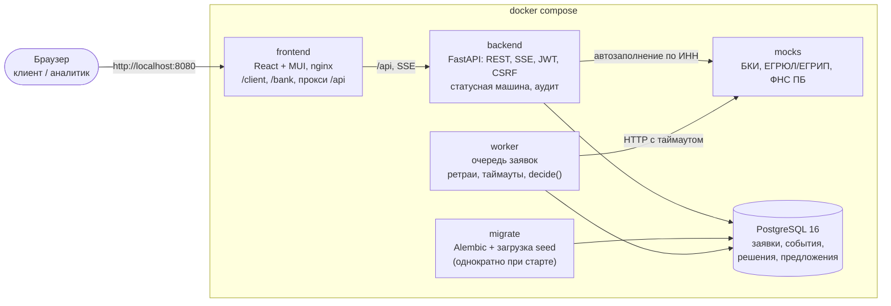

# Умный кредитный кабинет предпринимателя

Прототип цифрового кредитного конвейера для малого и микробизнеса. Кейс Alfa Hack 2026 (Changellenge × Альфа-Банк).

Предприниматель выбирает кредит под свою задачу, заполняет анкету по ИНН и следит за статусом заявки в реальном времени. Он получает не только «да» или «нет»: возможны **одобрение**, **контрпредложение** (меньше сумма, дольше срок или другой продукт), **запрос данных** или **отказ с понятной причиной**. Банк автоматически проверяет компанию в БКИ, ЕГРЮЛ/ЕГРИП и ФНС, считает скоринг и принимает решение. Нестандартные заявки уходят кредитному аналитику в отдельный кабинет.

> **Продуктовое знакомство — [«Продукт за 5 минут»](docs/product/overview.md):** ключевые возможности со скриншотами, результаты исследования и как они повлияли на решение, преимущества для клиента и банка. Ниже — техническая документация.

- [Быстрый старт](#быстрый-старт)
- [Тестовые аккаунты](#тестовые-аккаунты)
- [Сценарий проверки за 5 минут](#сценарий-проверки-за-5-минут)
- [Возможности](#возможности)
- [Архитектура](#архитектура)
- [Компоненты](#компоненты)
- [Переменные окружения](#переменные-окружения)
- [API](#api)
- [Проверки и тесты](#проверки-и-тесты)
- [Ресурсы и скорость](#ресурсы-и-скорость)
- [Документация](#документация)
- [Ограничения и что замокано](#ограничения-и-что-замокано)
- [Состояние и артефакты к сдаче](#состояние-и-артефакты-к-сдаче)

## Быстрый старт

Нужны Docker Engine с BuildKit и Docker Compose v2. Подойдёт Docker Desktop на обычном ноутбуке (Windows, macOS, Linux). Весь стенд занимает около 300 МБ оперативной памяти, GPU не нужен ([замеры](#ресурсы-и-скорость)). Интернет нужен только при первой сборке, чтобы скачать образы и зависимости. Платных сервисов не требуется.

**1. Настроить окружение** (один раз):

```bash
cp .env.example .env
python3 -c "import secrets; print(secrets.token_urlsafe(48))"
```

Вставьте выведенную строку в `.env` как значение `AUTH_JWT_SECRET=`. Остальные значения из примера подходят для локального запуска.

**2. Запустить:**

```bash
docker compose up --build --wait
```

Команда соберёт образы, применит миграции, загрузит тестовые данные (сервис `migrate`) и дождётся, пока все сервисы станут healthy. Первый запуск занимает несколько минут, повторные — быстрее.

**3. Открыть:**

| Что | Адрес |
| --- | --- |
| Кабинет клиента и кабинет аналитика | <http://localhost:8080> |
| Swagger UI (API) | <http://localhost:8000/docs> |
| Swagger моков БКИ, ЕГРЮЛ, ФНС | <http://localhost:8001/docs> |

Остановить стенд:

```bash
docker compose down
```

Чтобы начать с чистыми данными, удалите и тома: `docker compose down --volumes`.

## Тестовые аккаунты

Все данные синтетические. ИНН начинаются с `00`: такого кода региона нет, совпадения с реальными компаниями исключены. Каждому клиенту соответствует компания, заявка которой приводит к определённому исходу:

| Логин | Пароль | Компания | Что произойдёт с заявкой |
| --- | --- | --- | --- |
| `demo-approve` | `demo-2026` | ООО «Северный хлеб» | Одобрение на запрошенных условиях |
| `demo-term` | `demo-2026` | ИП Кузнецова А. С. | Контрпредложение: дольше срок |
| `demo-amount` | `demo-2026` | ООО «ТехноСклад» | Контрпредложение: меньше сумма |
| `demo-product` | `demo-2026` | ООО «Автосервис Плюс» | Контрпредложение: другой продукт под залог |
| `demo-info` | `demo-2026` | ИП Морозов И. Д. | Запрос данных: выручка расходится с ФНС |
| `demo-manual` | `demo-2026` | ООО «СтройМонтаж» | Ручная проверка аналитиком |
| `demo-stop` | `demo-2026` | ООО «Ромашка-Трейд» | Отказ: компания ликвидируется |
| `demo-risk` | `demo-2026` | ООО «Вкусная точка» | Отказ по скорингу |
| `demo-bki` | `demo-2026` | ИП Соколов Д. А. | БКИ дважды не отвечает → повтор → одобрение |
| `analyst` | `analyst-2026` | — | Кредитный аналитик банка |

Суммы, сроки и ИНН для каждой заявки — в [`docs/test-data.md`](docs/test-data.md). Пароли — тестовые значения только для локального стенда, в базе хранятся хеши.

## Сценарий проверки за 5 минут

Откройте <http://localhost:8080> в двух окнах, например обычном и приватном, чтобы видеть клиента и банк одновременно.

1. **Одобрение.** Войдите как `demo-approve`.
   - «Новая заявка» → «Закупить товар или сырьё» → «Кредитная линия на оборот».
   - Введите ИНН `0086906651`: название, адрес, ОКВЭД и дата регистрации заполнятся сами.
   - Сумма `5 000 000`, срок `18`, выручка `47 000 000` → «Отправить заявку».
   - Таймлайн пройдёт этапы «Проверка данных» → «Оценка» → «Решение» без перезагрузки страницы.
   - Примите условия и подпишите договор (симуляция): отметьте согласие, нажмите «Получить код» и введите 6 цифр, которые появятся на экране. Итоговый статус — «Деньги выданы».
2. **Ручная проверка.** Войдите как `demo-manual` и подайте заявку: кредитная линия, ИНН `0085481212`, 8 000 000 на 24 мес. Заявка уйдёт к специалисту.
3. **Кабинет банка.** Во втором окне войдите как `analyst`.
   - Откройте заявку из очереди «Заявки на ручную проверку»: в карточке анкета, показатели проверок БКИ, ЕГРЮЛ и ФНС в виде факторов решения, балл, класс риска и вклад каждого фактора.
   - Вынесите решение, например «Предложить другие условия». Клиент увидит его в своём окне.
4. **Отказоустойчивость.** Войдите как `demo-bki` и подайте заявку: экспресс-кредит, ИНН `005849901413`, 1 500 000 на 24 мес.
   - Мок БКИ дважды отвечает ошибкой 503, заявка ждёт в «Проверке данных», worker повторяет запрос сам.
   - После этого заявка одобряется. Повторы видны в логах: `docker compose logs worker`.
   - Чтобы показать сбой ещё раз: `curl -X POST http://localhost:8001/admin/reset`.
5. **Остальные исходы:** `demo-term`, `demo-amount`, `demo-product`, `demo-info`, `demo-stop`, `demo-risk`.

Все исходы можно проверить и без браузера, одной командой (нужен только Python 3.10+):

```bash
python3 api-collection/run_e2e.py
```

Скрипт проводит заявки всех 9 компаний через API, сверяет исходы с ожидаемыми, доводит их до выдачи или решения аналитика и печатает ✅/❌ по каждой.

Полные сценарии с ожидаемыми результатами по шагам, включая проверки безопасности и аудита, — в [`docs/test-scenarios.md`](docs/test-scenarios.md). Те же сценарии через API вручную — в коллекции [`api-collection/`](api-collection/README.md).

## Возможности

**Кабинет клиента**
- Подбор кредита по задаче («для чего деньги»), а не по названию продукта: 4 продукта, 6 целей.
- Анкета с автозаполнением по ИНН из ЕГРЮЛ/ЕГРИП. Вручную вводятся только сумма, срок и выручка.
- Таймлайн статуса и экран решения с объяснением простым языком.
- Принятие или отказ от предложения, дозагрузка данных и документов, подписание и выдача (симуляция), отзыв заявки.

**Обработка в банке**
- Конвейер: валидация → внешние проверки (БКИ, ЕГРЮЛ/ЕГРИП, ФНС «Прозрачный бизнес») → стоп-факторы → скоринг → решение.
- **Скоринг и решение — разные модули.** Скоркарта даёт балл и класс риска A–E, кредитная политика по классу, продукту и долговой нагрузке (DSCR) выбирает один из пяти исходов и рассчитывает условия контрпредложения. Правила — [`docs/credit-policy.md`](docs/credit-policy.md).
- **Кабинет аналитика:** очередь «серой зоны», карточка с факторами и вкладом каждого, решение с обязательным обоснованием.
- **Сводка конвейера** под очередью аналитика: сколько заявок в работе и на каждом этапе, сколько ждут аналитика и как долго, доля решений без участия человека, время до решения (медиана и 90-й перцентиль), выданные кредиты и их сумма.

**Надёжность и безопасность**
- **Проверки в отдельном worker.** API отвечает сразу, а сбой внешнего сервиса не роняет кабинет. Таймауты, повторы с нарастающей паузой, аренда задания (lease) и восстановление после падения worker.
- Очередь в PostgreSQL через `SELECT … FOR UPDATE SKIP LOCKED`, поэтому worker масштабируется горизонтально.
- Каждый переход статуса записывается в журнал событий (аудит) в той же транзакции.
- **Защита сессии и запросов:**
  - JWT в HttpOnly cookie, роли `client` и `underwriter`, отзыв сессии при выходе;
  - CSRF-токен и проверка `Origin` для всех изменяющих запросов;
  - пароли хешируются Argon2id;
  - защита от одновременного редактирования через `revision` и от двойной отправки через `Idempotency-Key`.
- Миграции Alembic и healthchecks всех сервисов, зависимости зафиксированы lock-файлами.

## Архитектура



Путь заявки: клиент отправляет анкету → backend переводит заявку в `SUBMITTED` и ставит задание в очередь → worker забирает задание, запрашивает три мока, сохраняет ответы и вызывает `decide()` → решение и новый статус пишутся в БД вместе с событием аудита → кабинет показывает изменение.

Подробнее:
- [архитектура](docs/architecture.md);
- [статусы заявки](docs/application-states.md) — 13 состояний и разрешённые переходы;
- [модель данных](docs/data-model.md).

## Компоненты

| Сервис | Порт на хосте | Технологии | Папка | Подробно |
| --- | --- | --- | --- | --- |
| `frontend` | 8080 | Vite, React 18, TypeScript, MUI, TanStack Query; nginx | `frontend/` | [frontend/README.md](frontend/README.md) |
| `backend` | 8000 | Python 3.12, FastAPI, SQLAlchemy 2 (async), Alembic, uv | `backend/` | [backend/README.md](backend/README.md) |
| `worker` | — | Тот же образ, что у backend, команда `python -m app.worker` | `backend/app/` | [backend/README.md](backend/README.md) |
| `migrate` | — | Тот же образ: `alembic upgrade head` и импорт `seed/` | `backend/`, `seed/` | [backend/README.md](backend/README.md) |
| `mocks` | 8001 | FastAPI, данные из `seed/companies.json` | `mocks/` | [mocks/README.md](mocks/README.md) |
| `db` | 5432 | PostgreSQL 16 | — | — |
| Кредитная политика | — | Чистые функции Python: стоп-факторы, скоркарта, матрица решения | `backend/app/decision/` | [docs/credit-policy.md](docs/credit-policy.md) |

Все порты открыты только на `127.0.0.1`. Для публичного развёртывания нужна отдельная настройка: HTTPS и `AUTH_COOKIE_SECURE=true`.

## Переменные окружения

Пример — [`.env.example`](.env.example). Файл `.env` не коммитится и не попадает в образы. Обязательно задать только `AUTH_JWT_SECRET`, остальное работает со значениями из примера.

| Переменная | Назначение | Пример / по умолчанию |
| --- | --- | --- |
| `AUTH_JWT_SECRET` | **Обязательно.** Секрет подписи JWT и CSRF, минимум 32 символа | пусто — сгенерировать |
| `POSTGRES_PASSWORD` | Пароль БД | `local-dev-change-me` (только локально) |
| `POSTGRES_DB`, `POSTGRES_USER` | Имя БД и пользователь | `alfa_hack` |
| `POSTGRES_HOST`, `POSTGRES_PORT` | Адрес БД при запуске backend вне Docker; порт БД на хосте | `localhost`, `5432` |
| `DB_READINESS_TIMEOUT` | Таймаут проверки БД в `/health/ready`, с | `2` |
| `BACKEND_PORT` | Порт API на хосте | `8000` |
| `FRONTEND_PORT` | Порт веб-кабинета на хосте | `8080` |
| `AUTH_ALLOWED_ORIGIN` | Точный origin, с которого разрешены изменяющие запросы | `http://localhost:8080` |
| `AUTH_COOKIE_SECURE` | Cookie только по HTTPS; `false` для локального HTTP | `false` |
| `AUTH_JWT_ISSUER`, `AUTH_JWT_AUDIENCE` | Издатель и аудитория JWT | `alfa-hack`, `alfa-hack-web` |
| `AUTH_SESSION_HOURS` | Срок сессии, ч | `8` |
| `MOCKS_PORT` | Порт моков на хосте | `8001` |
| `MOCKS_LATENCY_MS` | Искусственная задержка ответа моков, мс: делает этап проверки заметным в демо | `300` |
| `MOCKS_BASE_URL` | Адрес моков для backend вне Docker | `http://localhost:8001` |
| `EGRUL_TIMEOUT` | Таймаут автозаполнения по ИНН, с | `2` |
| `WORKER_POLL_INTERVAL` | Как часто worker проверяет очередь, с | `1` |
| `WORKER_HTTP_TIMEOUT` | Таймаут запроса к моку, с | `3` |
| `WORKER_ATTEMPT_TIMEOUT` | Таймаут одной попытки проверок, с | `30` |
| `WORKER_DB_TIMEOUT` | Таймаут операций worker с БД, с | `5` |
| `WORKER_LEASE_SECONDS` | Аренда задания: после неё задание упавшего worker подхватит другой | `45` |
| `WORKER_MAX_ATTEMPTS` | Максимум попыток проверок | `5` |
| `WORKER_RETRY_BASE`, `WORKER_RETRY_MAX` | Пауза между повторами (экспоненциальная), с | `2`, `30` |

Если меняете `FRONTEND_PORT`, поменяйте и `AUTH_ALLOWED_ORIGIN`, иначе изменяющие запросы получат 403. Детали авторизации — в [backend/README.md](backend/README.md#настройки-авторизации).

## API

- **Swagger UI:** <http://localhost:8000/docs> (на запущенном стенде), схема — <http://localhost:8000/openapi.json>.
- **Контракт** — [`docs/openapi.yaml`](docs/openapi.yaml), единственный источник правды для фронтенда и бэкенда. Типы фронтенда генерируются из него.
- **Коллекция запросов [Bruno](https://www.usebruno.com/)** — [`api-collection/`](api-collection/README.md). Это сквозной путь клиента, решения аналитика и негативные проверки; для каждой тестовой компании есть своё окружение.

Последовательность вызовов: `GET /api/auth/csrf` → `POST /api/auth/login` → снова `GET /api/auth/csrf` → бизнес-запросы с заголовками `X-CSRF-Token` и `Origin`.

## Проверки и тесты

Бэкенд и кредитная политика (нужны Python 3.12 и [uv](https://docs.astral.sh/uv/)):

```bash
cd backend
uv run --locked pytest -q                  # unit-тесты, включая decide() на всех синтетических компаниях
uv run --locked --env-file ../.env pytest -q --run-postgres   # плюс интеграционные тесты, нужна PostgreSQL 16 (docker compose up -d db)
uv run --locked ruff check . ../scripts
```

Моки и фронтенд:

```bash
cd mocks && uv run --locked pytest -q
cd frontend && pnpm install --frozen-lockfile && pnpm test && pnpm build
```

Сквозная Docker-проверка: собирает образы, поднимает отдельный стенд на свободных портах, прогоняет сценарии и удаляет за собой всё созданное.

```bash
python3 scripts/check_docker.py
```

Ручная проверка отказоустойчивости на запущенном стенде:

```bash
curl -i http://localhost:8000/health/ready   # 200
docker compose stop db
curl -i http://localhost:8000/health/ready   # 503, при этом /health/live отвечает 200
docker compose start db                      # readiness восстанавливается сам
```

Как запускать сервисы для разработки без Docker — в README компонентов: [backend](backend/README.md), [frontend](frontend/README.md), [mocks](mocks/README.md).

## Ресурсы и скорость

Замер 23.10.2026 на `main`: Docker Desktop, Windows 11, WSL 2, Docker выделено 7,6 ГБ. Память — `docker stats`, задержки — серии HTTP-запросов через nginx (`http://localhost:8080/api`), сценарии — те же 9 компаний, что в `api-collection/run_e2e.py`.

| Ресурс | Значение |
| --- | --- |
| Память в простое | ≈ 260 МБ на весь стенд: db 68, backend 68, worker 61, mocks 46, frontend 14 МБ |
| Память под нагрузкой (9 сценариев и 30 заявок подряд) | пик ≈ 300 МБ |
| GPU | не нужен |
| Образы на диске | ≈ 1,2 ГБ: postgres 622 МБ, backend 279, mocks 209, frontend 75 |
| Сборка и проверка с нуля | ≈ 3 мин на GitHub-раннере `ubuntu-24.04` (CI-задача «Clean Docker product») |

Это с большим запасом укладывается в ориентир организаторов: около 12 ГБ ОЗУ для серверной части и обычный ноутбук с 8 ГБ для веб-интерфейса.

**Целевые показатели.** Жёстких SLA для прототипа нет, поэтому мы сами выбрали критичные операции и цели для них:

| Операция | Цель | Замер | За счёт чего |
| --- | --- | --- | --- |
| Открыть карточку, список заявок, каталог продуктов | p95 < 200 мс | p95 15 / 31 / 20 мс (по 200 запросов) | Индексы; страница и `total` — одним SQL-запросом |
| Найти компанию по ИНН, создать черновик, отправить заявку | p95 < 1 с | p95 423 мс | Внешние проверки вынесены в worker; отправка — одна транзакция |
| От отправки до решения | < 5 с | ≈ 2 с у 8 компаний из 9, до 5 с у остальных | Worker опрашивает очередь раз в секунду (`WORKER_POLL_INTERVAL`) |
| Решение при сбое БКИ | < 30 с, заявка не теряется | ≈ 11 с: два повтора с паузой 2 и 4 с | Повторы с нарастающей паузой, аренда задания (lease), восстановление после падения worker |
| Поток заявок | очередь не копится | 30 заявок, отправленных подряд за ≈ 12 с: с одним worker последнее решение готово через ≈ 20 с после последней отправки, с тремя — через ≈ 2 с | `SELECT … FOR UPDATE SKIP LOCKED`, worker масштабируется: `docker compose up -d --scale worker=3` |

## Документация

| Документ | О чём |
| --- | --- |
| [Продукт за 5 минут](docs/product/overview.md) | Ключевые возможности со скриншотами, исследование → решения, преимущества |
| [Исследование](docs/product/research.md) | Рынок, конкуренты, боли предпринимателя, выводы для MVP |
| [Путь клиента (CJM)](docs/product/cjm.md) | Персона, путь клиента и обработка заявки в банке |
| [Scope MVP](docs/product/scope.md) | Пользователи, JTBD, что делаем и что осознанно не делаем |
| [Карта экранов](docs/product/screen-map.md) | Экраны клиента и аналитика, переходы, связь с API |
| [Тексты интерфейса](docs/product/ui-texts.md) | Все тексты и словари кодов причин; [JSON](docs/product/ui-texts.ru.json) — источник для фронтенда |
| [Цвета интерфейса](docs/product/design-tokens.md) | Палитра, цвета исходов, контраст WCAG |
| [Архитектура](docs/architecture.md) | Компоненты и их связи |
| [Статусы заявки](docs/application-states.md) | Диаграмма состояний и переходов |
| [Модель данных](docs/data-model.md) | Сущности и связи (Mermaid ER) |
| [OpenAPI](docs/openapi.yaml) | Контракт API |
| [Кредитная политика](docs/credit-policy.md) | Стоп-факторы, скоркарта, классы риска, матрица решения, контрпредложение |
| [Тестовые данные](docs/test-data.md) | Синтетические компании, ожидаемые исходы, аккаунты |
| [Тест-сценарии](docs/test-scenarios.md) | 13 сценариев проверки и журнал прогонов |
| [План команды](docs/team-plan.md) · [План бэкенда](backend/PLAN.md) | Роли, план по дням, статус этапов |

## Ограничения и что замокано

- **Внешние сервисы — только локальные моки** с синтетическими данными: БКИ, ЕГРЮЛ/ЕГРИП и ФНС «Прозрачный бизнес». Формат ответов близок к реальным источникам. Подробности — в [THIRD_PARTY_NOTICES.md](THIRD_PARTY_NOTICES.md).
- **Подписание договора и выдача денег симулируются.** Клиент подтверждает подпись кодом, который показывается прямо на экране (SMS кейс запрещает); электронной подписи и платежей нет. Как это устроено в боевой версии — в [архитектуре](docs/architecture.md#подписание-в-боевой-версии).
- **Нет:** email, SMS, мессенджеров и мобильного приложения. Всё взаимодействие происходит внутри веб-кабинета.
- **Нет платных API, подписок и лицензий.** Сторонние компоненты и их лицензии перечислены в [THIRD_PARTY_NOTICES.md](THIRD_PARTY_NOTICES.md).
- **Вход по готовым учётным записям, без регистрации.** По условиям кейса клиент — действующий клиент банка, регистрировать новое юрлицо не нужно. Поэтому на стенде заранее созданы тестовые клиенты и аналитик: вход по логину и паролю, сессия — JWT в HttpOnly cookie с ролью. В боевой версии вход шёл бы через интернет-банк для бизнеса (SSO), роль и компания приходили бы оттуда.
- **Одна учётная запись на компанию.** Разграничение полномочий собственника, директора, бухгалтера и доверенных лиц не моделируется: заявку подаёт и подписывает владелец учётной записи.
- **Повторная подача после отказа — новая заявка.** Запрос данных и контрпредложение обрабатываются в той же заявке, а отказ финальный: история и решение сохраняются, новая попытка — новая заявка. Подробнее — в [статусах заявки](docs/application-states.md#повторная-подача-и-изменения-в-одной-заявке).
- **Нет ML и LLM.** Решение принимают детерминированные правила: они прозрачны, объяснимы и воспроизводимы на синтетических данных. Где в процессе могла бы работать модель и как её подключить — в [архитектуре](docs/architecture.md#ии-и-ml-развитие).
- **Не входит в MVP:** залоговая экспертиза, сопровождение кредита после выдачи, госпрограммы, роли верификатора и кредитного комитета. Обоснование — в [scope](docs/product/scope.md#wont-осознанно-не-делаем-в-mvp).

## Состояние и артефакты к сдаче

Дедлайн — **26 октября 2026**, оценивается состояние `main` (тег `v1.0`). Ход работ по этапам — в [плане бэкенда](backend/PLAN.md).

| Артефакт | Где | Статус |
| --- | --- | --- |
| Docker Compose, запуск одной командой | [`docker-compose.yml`](docker-compose.yml) | ✅ |
| Lock-файлы зависимостей | `backend/uv.lock`, `mocks/uv.lock`, `frontend/pnpm-lock.yaml` | ✅ |
| README: назначение, архитектура, окружение, запуск, переменные, компоненты, сценарий проверки | этот файл | ✅ |
| Синтетические данные и тестовые аккаунты | [`seed/`](seed/), [`docs/test-data.md`](docs/test-data.md) | ✅ |
| THIRD_PARTY_NOTICES, включая замоканные интеграции | [`THIRD_PARTY_NOTICES.md`](THIRD_PARTY_NOTICES.md) | ✅ |
| Схема архитектуры | [`docs/architecture.md`](docs/architecture.md), раздел выше | ✅ |
| OpenAPI / Swagger, описание API | [`docs/openapi.yaml`](docs/openapi.yaml), `/docs` | ✅ |
| Коллекция запросов | [`api-collection/`](api-collection/README.md) | ✅ |
| Диаграмма состояний заявки | [`docs/application-states.md`](docs/application-states.md) | ✅ |
| Модель данных | [`docs/data-model.md`](docs/data-model.md) | ✅ |
| Тестовые сценарии | [`docs/test-scenarios.md`](docs/test-scenarios.md) | ✅ |
| Продуктовый обзор: возможности, скриншоты, исследование → решения | [`docs/product/overview.md`](docs/product/overview.md) | ✅ |
| Live-статус по SSE в кабинете | backend [PR #69](https://github.com/sb1nala/alfa-hack/pull/69), кабинет [PR #85](https://github.com/sb1nala/alfa-hack/pull/85) | ✅ |
| Ресурсы и целевые показатели скорости | [раздел выше](#ресурсы-и-скорость) | ✅ |
| ML-модель challenger для аналитика | [#35](https://github.com/sb1nala/alfa-hack/issues/35), [развитие](docs/architecture.md#ии-и-ml-развитие) | Не входит в MVP: решение на правилах, ML по условиям кейса не обязателен |
| Прогон «как жюри» на чистой машине | [журнал](docs/test-scenarios.md#прогон-как-жюри) | ✅ 25.10, финальный: чистый клон, сборка без кеша, «Быстрый старт» дословно, `run_e2e.py` 10/10, браузерные сценарии клиента и аналитика, отказ БД и перезапуск без потери данных |

Если репозиторий приватный, доступ нужно выдать аккаунту жюри `alfa-hack-2026`.
