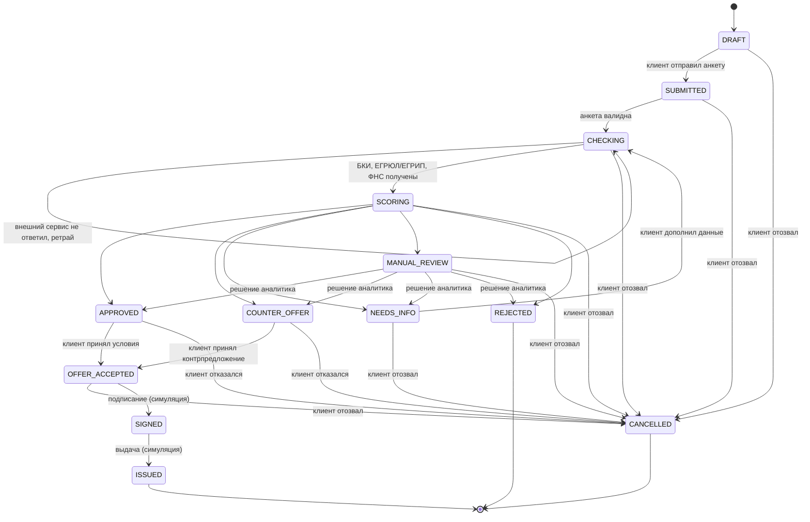

# Статусы заявки

Контракт для всей команды: бэкенд реализует переходы, фронтенд рисует таймлайн, риски выбирают исход, продукт пишет тексты к каждому статусу. Новый статус или переход — сначала правка этого файла.

Отмена клиентом: `CANCELLED` доступен из всех активных статусов до `SIGNED` — `DRAFT`, `SUBMITTED`, `CHECKING`, `SCORING`, `NEEDS_INFO`, `MANUAL_REVIEW`, `APPROVED`, `COUNTER_OFFER`, `OFFER_ACCEPTED`. Конечные статусы — `REJECTED`, `ISSUED`, `CANCELLED`: из них переходов нет. После `SIGNED` отменить нельзя.

Если клиент отменил заявку во время `CHECKING` или `SCORING`, результат worker к ней не применяется (проверка по ревизии, см. `docs/data-model.md`).

| Статус | Что видит клиент | Кто переводит дальше |
| --- | --- | --- |
| `DRAFT` | Черновик анкеты | Клиент |
| `SUBMITTED` | Заявка отправлена, проверяем анкету | Система |
| `CHECKING` | Запрашиваем данные из БКИ, ЕГРЮЛ/ЕГРИП, ФНС | Worker |
| `SCORING` | Оцениваем заявку | Worker (`decide()`) |
| `NEEDS_INFO` | Нужны дополнительные данные — что именно и зачем | Клиент |
| `MANUAL_REVIEW` | Заявку смотрит специалист | Андеррайтер |
| `APPROVED` | Одобрено на запрошенных условиях | Клиент |
| `COUNTER_OFFER` | Готовы выдать на других условиях (сумма, срок, продукт) | Клиент |
| `REJECTED` | Отказ с понятной причиной | — |
| `OFFER_ACCEPTED` | Условия приняты, готовим документы | Клиент |
| `SIGNED` | Договор подписан (симуляция) | Система |
| `ISSUED` | Деньги выданы (симуляция) | — |
| `CANCELLED` | Заявка отозвана | — |
