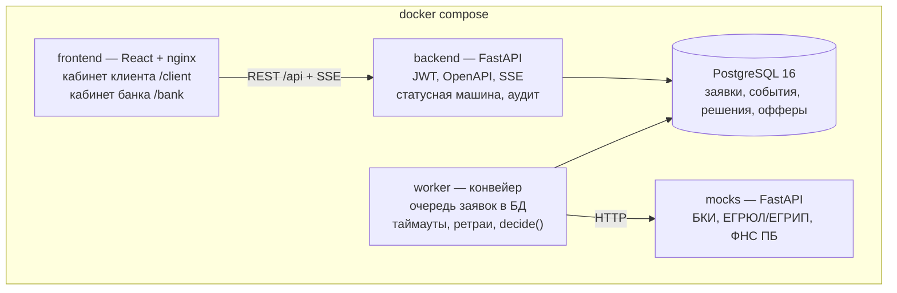

# Архитектура

Один `docker compose up` поднимает весь конвейер. Конвейер вынесен в отдельный worker: API отвечает быстро, а сбой внешнего сервиса не роняет кабинет.

| Компонент | Ответственность | Роль |
| --- | --- | --- |
| frontend | Кабинет клиента и кабинет сотрудника банка, live-статус по SSE | Фронтенд |
| backend | REST API, авторизация (роли `client`, `underwriter`), статусная машина, аудит переходов | Бэкенд |
| worker | Забирает заявки через `SELECT … FOR UPDATE SKIP LOCKED`, вызывает моки, затем `decide()` | Бэкенд |
| `backend/app/decision/` | Скоринг, стоп-факторы, матрица решения, контрпредложение — чистые функции без БД и сети | Риски и данные |
| mocks | Ответы БКИ, ЕГРЮЛ/ЕГРИП, ФНС «Прозрачный бизнес» по ИНН; режим сбоя для одного ИНН | Риски и данные |
| db | PostgreSQL 16, миграции Alembic при старте | Бэкенд |

Enterprise-аргументы: аудит каждого перехода, роли в JWT, миграции, healthchecks, ретраи и таймауты к внешним сервисам, горизонтальное масштабирование worker, все зависимости в lock-файлах.

## Подписание в боевой версии

В прототипе подписание — симуляция. Клиент соглашается с условиями, получает код подтверждения на экране и вводит его. Сервер переводит заявку `OFFER_ACCEPTED → SIGNED → ISSUED` одной транзакцией, оба перехода пишутся в аудит. Код генерируется в браузере и сервером не проверяется: он показывает шаг подтверждения, но защитой не является.

В боевой версии шаги остаются теми же, меняются исполнители:

| Шаг | Прототип | Боевая версия |
| --- | --- | --- |
| Договор | Образец в окне «Открыть договор» | Банк формирует договор по принятому предложению и сохраняет его неизменяемую версию |
| Подтверждение | Код на экране | Электронная подпись руководителя: в интернет-банке для бизнеса (сертификат уже выпущен банком) или через приложение Госключ. Без SMS |
| Проверка | — | Банк проверяет подпись и сертификат, сохраняет подписанный документ рядом с заявкой |
| Выдача | Мгновенный переход `SIGNED → ISSUED` | Отдельная системная операция: заявка в АБС, проводка на расчётный счёт; `ISSUED` — после подтверждения проводки |

Для этого в API понадобятся две операции: выпуск документа на подпись и приём подписи. Переход `OFFER_ACCEPTED → SIGNED` и аудит остаются прежними.

## ИИ и ML: развитие

В MVP моделей нет: решение принимают детерминированные правила в `backend/app/decision/`. По ответам организаторов ML и LLM не обязательны и сами по себе преимущества не дают, а правила прозрачны и проверяемы на синтетических данных: на каждую компанию есть тест, у аналитика виден вклад каждого фактора.

Где модель полезна и куда встанет:

| Место | Что делает | Как подключить, не трогая основной процесс |
| --- | --- | --- |
| Challenger-модель PD для аналитика ([#35](https://github.com/sb1nala/alfa-hack/issues/35)) | Рядом с правилами считает вероятность дефолта; видна только банку, на исход не влияет | Коэффициенты в JSON и чистая функция инференса в `backend/app/decision/`. Обучение — отдельная папка `ml/`, библиотеки обучения не попадают в образ. После накопления реальной истории выдач модель перекалибровывается и сравнивается с правилами |
| Объяснение решения и ответы на вопросы клиента | Пересказывает решение и причины простым языком | Отдельный сервис с OpenAI-совместимым API. Адрес, токен и модель — переменные окружения (`LLM_BASE_URL`, `LLM_API_KEY`, `LLM_MODEL`), чтобы проверяющие подключили своего провайдера. Модели — только с открытыми весами, с указанием источника (Hugging Face) в THIRD_PARTY_NOTICES |
| Разбор загруженных документов | Извлекает выручку из выписки или отчётности | Только OCR с открытыми весами в составе поставки; закрытые OCR-сервисы условиями кейса не допускаются |

Во всех трёх случаях модель — дополнительный слой: при её недоступности заявка проходит по правилам, как сейчас.

### Challenger-модель вероятности дефолта (#35)

**Главное:** на синтетических данных нельзя доказать качество прогноза, поэтому модель сознательно не влияет на решение. Исход заявки определяют только правила; модель — вторая оценка для аналитика, пока её точность не подтверждена на реальной истории выдач.

**Задача.** Оценить вероятность дефолта (PD) на горизонте 12 месяцев рядом с правилами. Результат видит только кредитный аналитик; в решении для клиента он не участвует.

**Входы.** Только то, что конвейер уже собирает и проверяет на момент решения: анкета (сумма, срок, цель, выручка), снимок продукта, проверенные ответы ЕГРЮЛ/ЕГРИП, ФНС и БКИ из `submission_checks`. Отдельный сбор данных не нужен: признаки те же, что у скоркарты (`backend/app/decision/scorecard.py`), плюс поля проверок.

**Модель и инференс.** Логистическая регрессия по WOE-преобразованным признакам. Её выбираем ради объяснимости: аналитику показывается вклад каждого признака так же, как сейчас вклад факторов правил. Артефакт — JSON с бинами и коэффициентами в репозитории, без внешних сервисов. Инференс — чистая детерминированная функция в `backend/app/decision/`; её вызывает worker в фазе расчёта решения. Библиотеки обучения живут в отдельной папке `ml/` и не попадают в рабочий образ.

**Где виден результат.** PD с версией модели и версией входов сохраняется в `risk_result` решения и показывается только в банковской карточке (`BankDecision`), как сейчас факторы скоринга. Клиентская проекция не меняется.

**Этапы внедрения.**
1. Интеграция на синтетических данных: модель считает PD параллельно правилам, аналитик видит обе оценки и их расхождения. Исход определяют только правила.
2. После накопления реальной истории выдач — обучение на реальных данных, сравнение с правилами в режиме champion/challenger, перекалибровка.
3. Перевод модели в советующий режим для автоматических решений — отдельное решение после подтверждённой точности.

**Оценка качества.** Нужна история кредитов с известными исходами. Синтетика проверяет интеграцию и воспроизводимость, но не качество прогноза. На реальных данных: разделение выборки по времени (out-of-time), ранжирование (Gini/AUC), калибровка вероятностей и сравнение с текущими правилами на одной и той же истории.

**Надёжность.** Ошибка или недоступность модели не останавливает конвейер: заявка проходит по правилам, как сейчас. Результат всегда сохраняется с версией модели и версией входов, поэтому решение можно воспроизвести и проверить постфактум.
