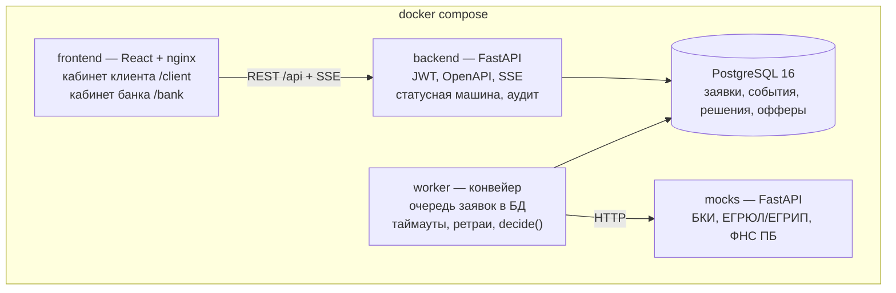

# Архитектура

Один `docker compose up` поднимает весь конвейер. Конвейер вынесен в отдельный worker: API отвечает быстро, а сбой внешнего сервиса не роняет кабинет.

| Компонент | Ответственность | Роль |
| --- | --- | --- |
| frontend | Кабинет клиента и кабинет сотрудника банка, live-статус по SSE | Фронтенд |
| backend | REST API, авторизация (роли `client`, `underwriter`), статусная машина, аудит переходов | Бэкенд |
| worker | Забирает заявки через `SELECT … FOR UPDATE SKIP LOCKED`, вызывает моки, затем `decide()` | Бэкенд |
| `backend/app/decision/` | Скоринг, стоп-факторы, матрица решения, контрпредложение — чистые функции без БД и сети | Риски и данные |
| mocks | Ответы БКИ, ЕГРЮЛ/ЕГРИП, ФНС «Прозрачный бизнес» по ИНН; режим сбоя для одного ИНН | Риски и данные |
| db | PostgreSQL 16, миграции Alembic при старте | Бэкенд |

Enterprise-аргументы: аудит каждого перехода, роли в JWT, миграции, healthchecks, ретраи и таймауты к внешним сервисам, горизонтальное масштабирование worker, все зависимости в lock-файлах.

## ИИ и ML: развитие

В MVP моделей нет: решение принимают детерминированные правила в `backend/app/decision/`. По ответам организаторов ML и LLM не обязательны и сами по себе преимущества не дают, а правила прозрачны и проверяемы на синтетических данных: на каждую компанию есть тест, у аналитика виден вклад каждого фактора.

Где модель полезна и куда встанет:

| Место | Что делает | Как подключить, не трогая основной процесс |
| --- | --- | --- |
| Challenger-модель PD для аналитика ([#35](https://github.com/sb1nala/alfa-hack/issues/35)) | Рядом с правилами считает вероятность дефолта; видна только банку, на исход не влияет | Коэффициенты в JSON и чистая функция инференса в `backend/app/decision/`. Обучение — отдельная папка `ml/`, библиотеки обучения не попадают в образ. После накопления реальной истории выдач модель перекалибровывается и сравнивается с правилами |
| Объяснение решения и ответы на вопросы клиента | Пересказывает решение и причины простым языком | Отдельный сервис с OpenAI-совместимым API. Адрес, токен и модель — переменные окружения (`LLM_BASE_URL`, `LLM_API_KEY`, `LLM_MODEL`), чтобы проверяющие подключили своего провайдера. Модели — только с открытыми весами, с указанием источника (Hugging Face) в THIRD_PARTY_NOTICES |
| Разбор загруженных документов | Извлекает выручку из выписки или отчётности | Только OCR с открытыми весами в составе поставки; закрытые OCR-сервисы условиями кейса не допускаются |

Во всех трёх случаях модель — дополнительный слой: при её недоступности заявка проходит по правилам, как сейчас.
