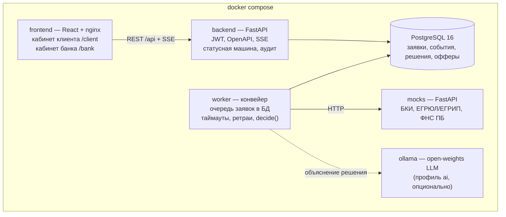

# Архитектура (черновик)

Один `docker compose up` поднимает весь конвейер. Конвейер вынесен в отдельный worker: API отвечает быстро, а сбой внешнего сервиса не роняет кабинет.

| Компонент | Ответственность | Роль |
| --- | --- | --- |
| frontend | Кабинет клиента и кабинет сотрудника банка, live-статус по SSE | Фронтенд |
| backend | REST API, авторизация (роли `client`, `underwriter`), статусная машина, аудит переходов | Бэкенд |
| worker | Забирает заявки через `SELECT … FOR UPDATE SKIP LOCKED`, вызывает моки, затем `decide()` | Бэкенд |
| `backend/app/decision/` | Скоринг, стоп-факторы, матрица решения, контрпредложение; инференс ML-модели challenger (PD для аналитика, на исход не влияет) | Риски и данные |
| `ml/` | Генерация обучающей выборки и обучение challenger; не входит в образы | Риски и данные |
| mocks | Ответы БКИ, ЕГРЮЛ/ЕГРИП, ФНС «Прозрачный бизнес» по ИНН; режим сбоя для одного ИНН | Риски и данные |
| db | PostgreSQL 16, миграции Alembic при старте | Бэкенд |

Enterprise-аргументы: аудит каждого перехода, роли в JWT, миграции, healthchecks, ретраи и таймауты к внешним сервисам, горизонтальное масштабирование worker, все зависимости в lock-файлах.
