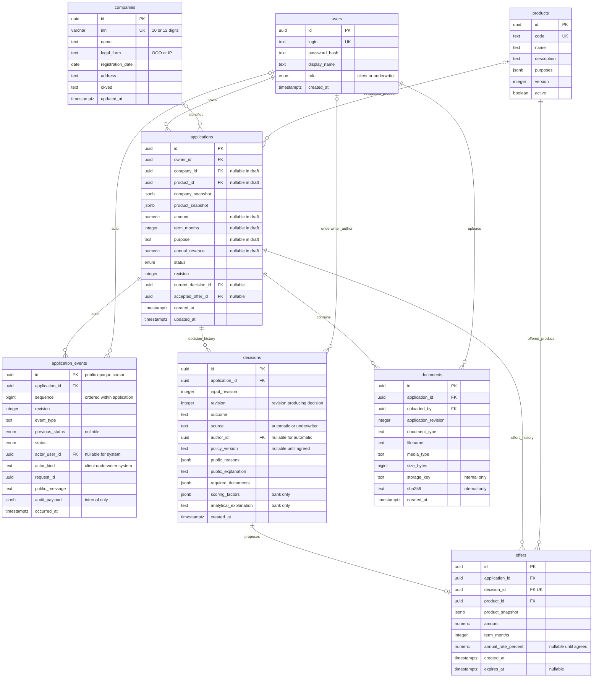

# Модель данных v1 и контракт API

Этот PR описывает будущую модель, **не создаёт таблицы, ORM-модели или миграции**.
Работающий каркас задачи 1 сохранён. Все бизнес-маршруты — заглушки: валидный запрос
возвращает `501` в едином формате ошибки; невалидный — `422` с `field_errors`.
Данные, cookies, сессии, файлы, очередь и SSE-поток не создаются. JWT, роли,
владение ресурсами и CSRF пока **только требования контракта**, без проверок.

Источники: [командный план](team-plan.md), [статусы](application-states.md),
[архитектура (черновик)](architecture.md). Документы PR #31 уже находятся в `main`.
Стартовые промпты — контекст, а не дополнительные поручения. В частности, фраза
«JWT в памяти» в старом промпте фронтенда заменяется согласованным решением задачи 2:
JWT в HttpOnly cookie, CSRF-токен в памяти. Предложение worker через очередь в БД
в архитектуре остаётся проектом следующего этапа.

Согласованы `/api`, роли `client` и `underwriter`, UUID, UTC, денежные строки рублей,
целые месяцы, cookie JWT, один origin, CSRF, стандартный EventSource, единая ошибка,
`409` для состояния/ревизии, пять исходов и набор статусов. Конкретные поля, имена
действий, границы транзакций и технические решения хранения ниже — **проект v1 этого
PR для ревью**, а не уже реализованная или ранее утверждённая кредитная политика.
Источник контракта фронтенда — [openapi.yaml](openapi.yaml); FastAPI генерирует его
из схем и маршрутов. В API нет реальных ставок, продуктовых лимитов или порогов скоринга.

## Связи



`applications.current_decision_id` и `applications.accepted_offer_id` — дополнительные
ссылки на последнюю запись решения и принятое предложение соответственно; они не
нарисованы обратными стрелками, чтобы не перегружать диаграмму. Будущие составные
ограничения должны гарантировать принадлежность обеих записей той же заявке.

## Сущности и ограничения

| Сущность | Назначение и инварианты следующего этапа |
| --- | --- |
| `users` | Уникальный логин, роль из двух значений. Пароль хранится только как безопасный хеш; в API нет хеша, JWT и сессионных секретов. Синтетические аккаунты появятся отдельно. |
| `companies` | Справочник синтетических ООО/ИП, уникальный ИНН строкой. В контракте проверяется длина/цифры, контрольная сумма — последующая проверка. Совпадение ИНН не даёт доступа к чужой заявке. |
| `products` | Стабильный `id`, уникальный `code`, версия описания. Архивация вместо удаления используемого продукта. Продуктовый каталог и кредитные ограничения согласуются отдельно; заглушка их не назначает. |
| `applications` | Ровно один владелец `owner_id → users.id`. Поля частичного черновика nullable; полнота проверяется при отправке, набор обязательных полей нужно согласовать. Снимки компании/продукта сохраняют контекст заявки при изменении справочников. |
| `application_events` | Неизменяемый аудит создания, каждого перехода (включая `CHECKING → CHECKING` при ретрае), редактирования, документов и решения. Уникальность `(application_id, sequence)`; UUID курсора не заменяет порядок. Актор, request_id, предыдущий/новый статус, ревизия и время обязательны по смыслу события. |
| `decisions` | Неизменяемая история решений, не перезапись последнего. Ровно пять исходов: `APPROVED`, `COUNTER_OFFER`, `NEEDS_INFO`, `MANUAL_REVIEW`, `REJECTED`. `input_revision` связывает расчёт с версией входных данных; `revision` — с результатом. Публичная и внутренняя части разделены. |
| `offers` | 0..1 предложение на решение, обязательно при `APPROVED`/`COUNTER_OFFER`, отсутствует при остальных исходах. Собственный продукт позволяет предложить другой продукт. Условия — неизменяемый снимок; принятие через ссылку из заявки и событие аудита. |
| `documents` | Принадлежит ровно одной заявке, фиксирует загрузившего и ревизию. Клиент видит безопасные метаданные, но не storage_key/путь/контрольную сумму. Реальное хранилище и проверка содержимого — следующий этап. |

Все PK/FK идентификаторов — PostgreSQL `UUID`. Время — `TIMESTAMPTZ`, приложение
сериализует ISO 8601 в UTC (`Z`); дата регистрации — `DATE`. Суммы — проект
`NUMERIC(29,2)`, в JSON только строки с двумя знаками (`"100000.00"`), не float.
Запрошенная сумма положительна, выручка неотрицательна; это ограничения формата,
не пороги кредитной политики. Максимальная длина денежной строки — 30 символов.
Срок — положительное целое число месяцев. Ставка — отдельная десятичная строка
процентов годовых, в примерах `null`: реальная шкала и значения не назначены.

Предлагаемые индексы: `applications(owner_id, updated_at, id)` для списка клиента;
`applications(status, updated_at, id)` для очереди; уникальный
`application_events(application_id, sequence)`; `decisions(application_id, revision)`;
`documents(application_id, created_at)`. Не удалять каскадно аудит, решения и офферы.
Политики удаления и сроки хранения требуют отдельного решения.

## Ревизии, решения и аудит

1. Черновик создаётся с `revision=1`, владельцем из будущей сессии и событием создания
   (`application_updated`, previous_status=null). Клиент не назначает владельца или статус.
2. Каждая мутация заявки принимает `expected_revision`. Атомарное изменение возможно
   только при совпадении ревизии и допустимом статусе. Изменение анкеты, статуса,
   загрузка документа и решение повышают ревизию; иначе `409`, без частичной записи.
3. Изменение заявки, новая запись решения/оффера/документа и аудит фиксируются одной
   транзакцией. Несколько событий одной операции могут иметь одну revision, но разные
   sequence и UUID. Worker обязан проверить входную ревизию перед фиксацией результата.
4. `current_decision_id` указывает на последнее решение. При возобновлении проверки
   прошлое решение остаётся в истории и может отображаться в карточке с новым статусом.
   Устаревший offer_id принимать нельзя; проверяются принадлежность, актуальность,
   статус и ревизия. Ограничения актуальности/срока предложения реализуются позднее.
5. Клиентские `decision`, история и SSE не содержат scoring_factors,
   analytical_explanation, сырых ответов моков, служебных акторов и audit_payload.
   Банковская карточка имеет отдельную схему и историю всех решений.
6. Ручное решение из `MANUAL_REVIEW` даёт только `APPROVED`, `COUNTER_OFFER`,
   `NEEDS_INFO` или `REJECTED`. Возврат в `MANUAL_REVIEW` не указан среди переходов.
   `NEEDS_INFO` содержит непустой перечень требуемых документов; `REJECTED` — причины;
   одобрение/контрпредложение — условия предложения. Словари причин и документов
   согласуются с рисками; демонстрационные коды `DEMO_*` не являются правилами.

**Неоднозначность отмены:** [application-states.md](application-states.md) в тексте
разрешает отмену «из любого статуса до SIGNED», диаграмма явно содержит только
`COUNTER_OFFER → CANCELLED`, а `REJECTED` объявлен терминальным. Рекомендация:
разрешить отмену из активных `DRAFT`, `SUBMITTED`, `CHECKING`, `SCORING`, `NEEDS_INFO`,
`MANUAL_REVIEW`, `APPROVED`, `COUNTER_OFFER`, `OFFER_ACCEPTED`; запретить из
`REJECTED`, `SIGNED`, `ISSUED`, `CANCELLED`. Уточнить исходный документ до реализации
статусной машины. Этот PR не меняет документ, не утверждает новые переходы и не
вводит статусов; `allowed_actions` в примерах отражает это предложение.

## API v1

Все пути ниже имеют префикс `/api`. Будущие успехи и примеры описаны в YAML;
реальное поведение заглушек — `501`, ошибки формы/типов — `422`. Health endpoints
`/health/live`, `/health/ready` и Swagger `/docs`, `/openapi.json` сохранены.

| Роль | Метод и путь | Будущий результат |
| --- | --- | --- |
| Анонимный/обе | `GET /auth/csrf` | `200`, CSRF-токен, привязанный к HttpOnly контексту, Cache-Control: no-store |
| Анонимный + CSRF | `POST /auth/login` | `200`, пользователь; JWT только через Set-Cookie |
| Обе + CSRF | `POST /auth/logout` | `204`, инвалидация и очистка cookies |
| Обе | `GET /auth/me` | `200`, пользователь без JWT |
| Обе | `GET /products` | `200`, каталог |
| client | `GET /companies/lookup?inn=...` | `200`, автозаполнение или company=null |
| client + CSRF | `POST /applications` | `201`, частичный черновик |
| client | `GET /applications` | `200`, только свои, offset/limit/status |
| client | `GET /applications/{id}` | `200`, публичная карточка |
| client + CSRF | `PATCH /applications/{id}` | `200`, редактирование DRAFT; null очищает поле |
| client + CSRF | `POST /applications/{id}/submit` | `202`, SUBMITTED; Idempotency-Key и expected_revision |
| client + CSRF | `POST /applications/{id}/cancel` | `200`, CANCELLED с оговоркой выше |
| client + CSRF | `POST /applications/{id}/accept-offer` | `200`, OFFER_ACCEPTED |
| client + CSRF | `POST /applications/{id}/additional-info` | `202`, CHECKING |
| client + CSRF | `POST /applications/{id}/documents` | `201`, multipart: file/document_type/expected_revision |
| Владелец/underwriter | `GET /applications/{id}/documents` | `200`, метаданные |
| Владелец/underwriter | `GET /applications/{id}/documents/{document_id}/download` | `200`, application/octet-stream, attachment |
| client + CSRF | `POST /applications/{id}/sign` | `200`, SIGNED, симуляция |
| Владелец/underwriter | `GET /applications/{id}/history` | `200`, публичная история, cursor/limit |
| Владелец/underwriter | `GET /applications/{id}/events` | `200`, text/event-stream |
| underwriter | `GET /underwriter/applications` | `200`, очередь; по умолчанию MANUAL_REVIEW |
| underwriter | `GET /underwriter/applications/{id}` | `200`, отдельная банковская карточка |
| underwriter + CSRF | `POST /underwriter/applications/{id}/decision` | `200`, решение и новая карточка |

Будущий протокол: один origin, `access_token` — HttpOnly cookie (Secure при HTTPS,
SameSite=Lax, Path=/), JWT не читается JavaScript и не возвращается в JSON.
`GET /auth/csrf` доступен до входа и связывает возвращаемый CSRF-токен с
`csrf_context` (HttpOnly cookie). CSRF-токен хранится в памяти и передаётся через
`X-CSRF-Token` во всех POST/PATCH, включая login/logout. Контекст/токен ротируется
при входе/выходе, затем клиент снова вызывает GET /auth/csrf. При реализации нужны
проверка Origin и проверка связи токена с контекстом/сессией. В OpenAPI требования
cookie и CSRF объединены через AND. Swagger не может прочитать HttpOnly JWT.

`Idempotency-Key` отправки — UUID клиента для одной попытки; область ключа:
(пользователь, заявка, submit). Проект срока хранения — минимум 24 часа.
Повтор с тем же ключом и JSON возвращает исходный `202` и снимок ответа без новой
обработки, даже если ревизия уже выросла; проверка повтора предшествует ревизии.
Повтор ключа с другим JSON — `409`. Новый ключ при устаревшей ревизии или статусе
не DRAFT — `409`. Все проверки и сохранение результата должны быть атомарны;
в текущей задаче ключ только валидируется как UUID, ничего не хранится.

Ошибки: `code`, `message`, `field_errors`, `request_id`; request_id — UUID, также
в `X-Request-ID`. Валидация — `422 VALIDATION_ERROR`, пути вроде `body.term_months`.
Вне валидации `field_errors=[]`. Заглушка — `501 NOT_IMPLEMENTED`; будущие ошибки:
`400 BAD_REQUEST`, `401 UNAUTHENTICATED`, `403 FORBIDDEN`, `404 NOT_FOUND`,
`409 CONFLICT`, `410 EVENT_CURSOR_EXPIRED` (history/SSE), `413 FILE_TOO_LARGE`,
`415 UNSUPPORTED_MEDIA_TYPE`, `429 RATE_LIMITED`, `500 INTERNAL_ERROR`.
Чужая заявка/документ — `404`, неправильная роль/CSRF — `403`. Тексты могут меняться,
фронтенд опирается на `code`. В ошибках нет введённых паролей, файлов и деталей БД.

SSE — стандартный EventSource с same-origin cookies. В YAML есть `text/event-stream`,
структура `SSEEvent` и четыре типа событий, примеры `id/event/data`, `retry: 3000`,
комментарий heartbeat примерно раз в 15 секунд. `Last-Event-ID` браузер передаёт
сам при reconnect; произвольные заголовки в EventSource не нужны. Порядок определяется
sequence, повторы убираются по UUID id. После onopen клиент перечитывает карточку
и учитывает revision; без курсора поток содержит новые события от подключения.
Устаревший курсор — `410`, чужой — `404`; при onerror следует перечитать
карточку/историю (EventSource не раскрывает HTTP-статус). Реального потока пока нет.

## Технические сущности следующего этапа

- **Сессии/CSRF-контексты**: отзыв JWT, хранение привязки CSRF, сроки действия,
  ротация и инвалидирование. Не добавлены в ER как уже существующие таблицы.
- **Очередь/outbox**: проект хранения задач в PostgreSQL с `FOR UPDATE SKIP LOCKED`,
  атомарность отправки и постановки задачи, lease, попытки/таймауты, ретраи.
  Worker, SSE fan-out, доставка и период хранения событий проектируются отдельно.
- **Ключи идемпотентности**: уникальная область ключа, канонический хеш запроса,
  исходный HTTP-ответ, срок хранения. Это отдельное техническое хранилище, не поле JWT.
- **Хранилище документов**: место хранения, MIME/размеры, безопасность имён,
  доступ по роли/владельцу, отказоустойчивость загрузки и транзакции метаданных.

SQLAlchemy 2 async, PostgreSQL 16 и будущий Alembic остаются целевым стеком.
В рамках задачи 2 никакие ORM-сущности, миграции и обработчики конвейера не создаются.

## Экспорт и проверка

Из корня репозитория:

```bash
cd backend
uv sync --locked
uv run --locked python -m app.export_openapi
uv run --locked python -m app.export_openapi --check
uv run --locked ruff check . ../scripts
uv run --locked ruff format --check . ../scripts
uv run --locked pytest -q
```

Экспорт строит ту же схему, что `/openapi.json`, без lifespan, чтения настроек,
паролей и подключения к БД. Вывод по умолчанию — `docs/openapi.yaml` относительно
репозитория, а не cwd. Можно задать `--output /tmp/openapi.yaml`. Повторный экспорт
побайтово одинаков. `--check` возвращает ненулевой код при рассинхронизации.
Тесты проверяют структуру OpenAPI 3.1, все локальные ссылки, примеры запросов/ответов,
бинарные/SSE-примеры, пять исходов и изоляцию банковских схем. Экспорт восстанавливает
JSON null в примерах после стандартной сериализации FastAPI: null нельзя терять
в обязательных nullable полях.

Проверка TypeScript во временной папке без изменения frontend:

```bash
contract_path="$PWD/../docs/openapi.yaml"
contract_check_dir="$(mktemp -d)"
cd "$contract_check_dir"
npm exec --yes --package=openapi-typescript@7.10.1 -- openapi-typescript "$contract_path" -o api.d.ts
npm exec --yes --package=typescript@5.9.3 -- tsc --noEmit --strict --skipLibCheck false api.d.ts
```

Для Prism можно использовать YAML и именованные синтетические примеры успешных
ответов; живые заглушки всегда возвращают 501. Нужный пример Prism выбирается
заголовком `Prefer: example=<имя>`. Это поведение mock-сервера, не backend.

Перед реализацией следующего этапа согласовать с фронтендом: имена/поля действий,
минимальную анкету для submit, CSRF bootstrap/ротацию, обновление ревизии после загрузки,
Idempotency-Key и reconnect SSE; с рисками: словари причин/документов, формат факторов,
публичные объяснения, поля условий/ставки и версию политики. С продуктом — уточнение
отмены в документе состояний. Этот PR не задаёт кредитных правил.
