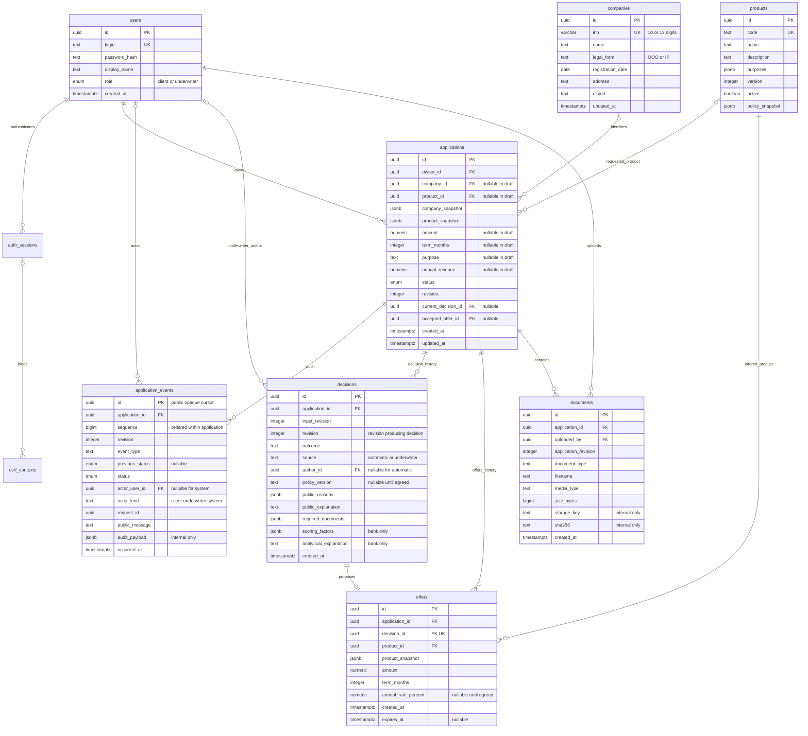

# Модель данных v1 и контракт API

B03 ([PR #41](https://github.com/sb1nala/alfa-hack/pull/41)) добавил восемь бизнес-моделей
и миграцию `b03_initial`. B04 добавляет технические `auth_sessions`, `csrf_contexts`
миграцией `b04_auth` поверх B03; начальная миграция сохранена. Общая Base.metadata
используется для сравнения схемы; таблицы создаются только миграциями.
B05 добавляет nullable `products.policy_snapshot` отдельной миграцией
`b05_product_policy`: исходные условия и policy_version из seed владельца рисков.
UUID продукта сохраняется, изменение описания/условий увеличивает его version.
Auth csrf/login/me/logout, JWT, роли, CSRF/Origin и зависимости доступа реализованы.
B05 реализует каталог продуктов, lookup через локальный мок ЕГРЮЛ и CRUD черновиков
с фильтрацией собственных заявок. B06 реализует submit/cancel, общий механизм переходов,
транзакционный аудит, снимок входов, идемпотентность и очередь в PostgreSQL.
Остальные маршруты после доступа возвращают 501; worker, файлы и SSE идут далее.

Источники: [командный план](team-plan.md), [статусы](application-states.md),
[архитектура (черновик)](architecture.md). Документы PR #31 уже находятся в `main`.
Стартовые промпты — контекст, а не дополнительные поручения. В частности, фраза
«JWT в памяти» в старом промпте фронтенда заменяется согласованным решением задачи 2:
JWT в HttpOnly cookie, CSRF-токен в памяти. Очередь в БД реализована в B06;
процесс worker и обработка заданий относятся к B07.

Согласованы `/api`, роли `client` и `underwriter`, UUID, UTC, денежные строки рублей,
целые месяцы, cookie JWT, один origin, CSRF, стандартный EventSource, единая ошибка,
`409` для состояния/ревизии, пять исходов и набор статусов. Конкретные поля, имена
действий и границы транзакций описаны ниже; нереализованные операции явно отмечены.
Реализованная схема хранения не назначает кредитную политику.
Источник контракта фронтенда — [openapi.yaml](openapi.yaml); FastAPI генерирует его
из схем и маршрутов. В API нет реальных ставок, продуктовых лимитов или порогов скоринга.

## Связи



`applications.current_decision_id` и `applications.accepted_offer_id` — дополнительные
ссылки на последнюю запись решения и принятое предложение соответственно; они не
нарисованы обратными стрелками, чтобы не перегружать диаграмму. Составные FK B03
гарантируют принадлежность обеих записей той же заявке; аналогичный FK связывает
`offers(application_id, decision_id)` с `decisions(application_id, id)`. Уникальные
пары `(application_id, id)` в decisions/offers служат целями этих ссылок. Обратные FK
создаются после таблиц и снимаются первыми при downgrade, без `CASCADE`.

## Сущности и ограничения

| Сущность | Назначение и требования к схеме/будущим сервисам |
| --- | --- |
| `users` | Уникальный логин, роль из двух значений. Пароль хранится только как безопасный хеш; в API нет хеша, JWT и сессионных секретов. Синтетические аккаунты импортируются явной командой B04 из seed/accounts.json. |
| `companies` | Справочник синтетических ООО/ИП, уникальный ИНН строкой. В контракте проверяется длина/цифры, контрольная сумма — последующая проверка. Совпадение ИНН не даёт доступа к чужой заявке. |
| `products` | Стабильный `id`, уникальный `code`, версия описания. Архивация вместо удаления используемого продукта. Продуктовый каталог и кредитные ограничения согласуются отдельно; заглушка их не назначает. |
| `applications` | Ровно один владелец `owner_id → users.id`. Поля частичного черновика nullable; полнота проверяется при отправке по рабочим требованиям B06 (см. backend/README.md). Снимки компании/продукта сохраняют контекст заявки при изменении справочников. |
| `application_events` | Неизменяемый аудит создания, каждого перехода (включая `CHECKING → CHECKING` при ретрае), редактирования, документов и решения. Уникальность `(application_id, sequence)`; UUID курсора не заменяет порядок. Актор, request_id, предыдущий/новый статус, ревизия и время обязательны по смыслу события. |
| `decisions` | Неизменяемая история решений, не перезапись последнего. Ровно пять исходов: `APPROVED`, `COUNTER_OFFER`, `NEEDS_INFO`, `MANUAL_REVIEW`, `REJECTED`. `input_revision` связывает расчёт с версией входных данных; `revision` — с результатом. Публичная и внутренняя части разделены. |
| `offers` | 0..1 предложение на решение, обязательно при `APPROVED`/`COUNTER_OFFER`, отсутствует при остальных исходах. Собственный продукт позволяет предложить другой продукт. Условия — неизменяемый снимок; принятие через ссылку из заявки и событие аудита. |
| `documents` | Принадлежит ровно одной заявке, фиксирует загрузившего и ревизию. Клиент видит безопасные метаданные, но не storage_key/путь/контрольную сумму. Реальное хранилище и проверка содержимого — следующий этап. |

Все PK/FK идентификаторов — PostgreSQL `UUID`. Время — `TIMESTAMPTZ`, приложение
сериализует ISO 8601 в UTC (`Z`); дата регистрации — `DATE`. Суммы —
`NUMERIC(29,2)`, в JSON только строки с двумя знаками (`"100000.00"`), не float.
Запрошенная сумма положительна, выручка неотрицательна; это ограничения формата,
не пороги кредитной политики. Максимальная длина денежной строки — 30 символов.
Срок — положительное целое число месяцев. Ставка — отдельный `NUMERIC` без
заданной точности/scale (Python `Decimal`),
в API десятичная строка процентов годовых, в примерах `null`. БД запрещает
отрицательную ставку согласно формату API; верхний порог и банковская шкала не назначены.

Реализованные индексы: `applications(owner_id, updated_at, id)` для списка клиента;
`applications(status, updated_at, id)` для очереди; уникальный
`application_events(application_id, sequence)`; `decisions(application_id, revision)`;
`documents(application_id, created_at)`. Все FK используют PostgreSQL NO ACTION:
каскадного удаления аудита, решений и
предложений нет. История блокирует удаление заявки, ссылки блокируют удаление
используемых владельцев/справочников. Политики удаления и сроки хранения требуют
отдельного решения.

## Что обеспечивает БД в B03

- UUID, TIMESTAMPTZ, DATE, JSONB, точные NUMERIC; поля черновика nullable по B02.
- NOT NULL, уникальные login/inn/code, формат ИНН и значения ролей, статусов,
  типов событий, legal_form, source и outcome. Значения ORM берутся из enum/литералов
  существующих Pydantic-схем; миграция фиксирует их на момент B03.
- Положительные amount/term_months/revision/input_revision/application_revision/
  sequence/version; неотрицательные annual_revenue/size_bytes/annual_rate_percent.
- Уникальные `(application_id, sequence)` и `offers.decision_id`; все ссылки на
  владельца и сущности, включая составные связи одной заявки.
- Индексы списков клиента/банка, истории, решений и документов, а также FK справочников
  и акторов. Неизменяемость истории от UPDATE/прямого DELETE пока не обеспечивается
  триггерами или отдельными правами БД.

`created_at`, `updated_at`, `occurred_at` при вставке получают `now()`; UUID создаёт
ORM. Автоматического изменения `updated_at`, revision или sequence нет:
сервисы B05/B06 обновляют их явно в одной транзакции. JSONB хранит снимки и структурированные
списки; проверка их вложенной структуры остаётся обязанностью Pydantic и сервисов.

## Ревизии, решения и аудит — сервисные инварианты

B03 реализует ограничения схемы; B04 проверяет роль и владельца ресурса.
B05 реализует первые три правила для создания/редактирования DRAFT, B06 — для submit/cancel;
БД-блокировка строки сериализует проверку ревизии и выделение sequence.
Остальные бизнес-операции ниже пока относятся к последующим этапам.
Следующим этапам предстоит обеспечить полноту submit, допустимые переходы, неизменяемость
истории, атомарность ревизии/аудита и конкурентное выделение sequence. Также сервисы
проверят исход решения и наличие предложения, обязательные причины/документы,
актуальность current_decision и принятого предложения, срок предложения и политику.
Наличие FK не означает, что решение последнее или предложение допустимо принять.

1. Черновик создаётся с `revision=1`, владельцем из текущей сессии и событием создания
   (`application_updated`, previous_status=null). Клиент не назначает владельца или статус.
2. Каждая мутация заявки принимает `expected_revision`. Атомарное изменение возможно
   только при совпадении ревизии и допустимом статусе. Изменение анкеты, статуса,
   загрузка документа и решение повышают ревизию; иначе `409`, без частичной записи.
3. Изменение заявки, новая запись решения/оффера/документа и аудит фиксируются одной
   транзакцией. Несколько событий одной операции могут иметь одну revision, но разные
   sequence и UUID. Worker обязан проверить версию входов, статус и действующую lease перед фиксацией
   результата; revision состояния может расти при собственных переходах worker (см. B06 ниже).
4. `current_decision_id` указывает на последнее решение. При возобновлении проверки
   прошлое решение остаётся в истории и может отображаться в карточке с новым статусом.
   Устаревший offer_id принимать нельзя; проверяются принадлежность, актуальность,
   статус и ревизия. Ограничения актуальности/срока предложения реализуются позднее.
5. Клиентские `decision`, история и SSE не содержат scoring_factors,
   analytical_explanation, сырых ответов моков, служебных акторов и audit_payload.
   Банковская карточка имеет отдельную схему и историю всех решений.
6. Ручное решение из `MANUAL_REVIEW` даёт только `APPROVED`, `COUNTER_OFFER`,
   `NEEDS_INFO` или `REJECTED`. Возврат в `MANUAL_REVIEW` не указан среди переходов.
   `NEEDS_INFO` содержит непустой перечень требуемых документов; `REJECTED` — причины;
   одобрение/контрпредложение — условия предложения. Словари причин и документов
   согласуются с рисками; демонстрационные коды `DEMO_*` не являются правилами.

Отмена — согласно актуальному [application-states.md](application-states.md):
из активных состояний до SIGNED; REJECTED, ISSUED и CANCELLED конечные.
Submit/cancel и проверка статуса/ревизии реализованы в B06.

## API v1

Все пути ниже имеют префикс `/api`. Будущие успехи и примеры описаны в YAML;
auth, каталог/черновики и submit/cancel реализованы; остальные после доступа — `501`; ошибки
формы/типов авторизованного запроса — `422`. Health endpoints
`/health/live`, `/health/ready` и Swagger `/docs`, `/openapi.json` сохранены.

| Роль | Метод и путь | Результат (для заглушек — будущий) |
| --- | --- | --- |
| Анонимный/обе | `GET /auth/csrf` | `200`, CSRF-токен, привязанный к HttpOnly контексту, Cache-Control: no-store |
| Анонимный + CSRF | `POST /auth/login` | `200`, пользователь; JWT только через Set-Cookie |
| Обе + CSRF | `POST /auth/logout` | `204`, инвалидация и очистка cookies |
| Обе | `GET /auth/me` | `200`, пользователь без JWT |
| Обе | `GET /products` | `200`, каталог |
| client | `GET /companies/lookup?inn=...` | `200`, автозаполнение или company=null |
| client + CSRF | `POST /applications` | `201`, частичный черновик |
| client | `GET /applications` | `200`, только свои, offset/limit/status |
| client | `GET /applications/{id}` | `200`, публичная карточка |
| client + CSRF | `PATCH /applications/{id}` | `200`, редактирование DRAFT; null очищает поле |
| client + CSRF | `POST /applications/{id}/submit` | `202`, SUBMITTED; Idempotency-Key и expected_revision |
| client + CSRF | `POST /applications/{id}/cancel` | `200`, CANCELLED из активных состояний до SIGNED |
| client + CSRF | `POST /applications/{id}/accept-offer` | `200`, OFFER_ACCEPTED |
| client + CSRF | `POST /applications/{id}/additional-info` | `202`, CHECKING |
| client + CSRF | `POST /applications/{id}/documents` | `201`, multipart: file/document_type/expected_revision |
| Владелец/underwriter | `GET /applications/{id}/documents` | `200`, метаданные |
| Владелец/underwriter | `GET /applications/{id}/documents/{document_id}/download` | `200`, application/octet-stream, attachment |
| client + CSRF | `POST /applications/{id}/sign` | `200`, SIGNED, симуляция |
| Владелец/underwriter | `GET /applications/{id}/history` | `200`, публичная история, cursor/limit |
| Владелец/underwriter | `GET /applications/{id}/events` | `200`, text/event-stream |
| underwriter | `GET /underwriter/applications` | `200`, очередь; по умолчанию MANUAL_REVIEW |
| underwriter | `GET /underwriter/applications/{id}` | `200`, отдельная банковская карточка |
| underwriter + CSRF | `POST /underwriter/applications/{id}/decision` | `200`, решение и новая карточка |

Реализованный протокол: один origin, `access_token` — HttpOnly cookie (Secure при HTTPS,
SameSite=Lax, Path=/), JWT не читается JavaScript и не возвращается в JSON.
`GET /auth/csrf` доступен до входа и связывает возвращаемый CSRF-токен с
`csrf_context` (HttpOnly cookie). CSRF-токен хранится в памяти и передаётся через
`X-CSRF-Token` во всех POST/PATCH, включая login/logout. Контекст/токен ротируется
при входе/выходе, затем клиент снова вызывает GET /auth/csrf. Реализованы обязательный точный Origin из настроек
и криптографическая связь токена с серверным контекстом/сессией. В OpenAPI требования
cookie и CSRF объединены через AND. Swagger не может прочитать HttpOnly JWT.

`Idempotency-Key` отправки — UUID клиента для одной попытки; область ключа:
(пользователь, заявка, submit, UUID). Срок хранения успешного результата — минимум 24 часа.
Повтор с тем же ключом и JSON возвращает исходный `202` и снимок ответа без новой
обработки, даже если ревизия уже выросла; проверка повтора предшествует ревизии.
Повтор ключа с другим JSON — `409`. Новый ключ при устаревшей ревизии или статусе
не DRAFT — `409`. Все проверки и сохранение результата атомарны в B06. Валидированное тело хранится
как JSONB, сравнение не зависит от пробелов/порядка ключей. Успех хранится снимком,
не пересобирается из текущей карточки; повтор работает после отмены и рестарта.
Проверяется после авторизации/владения/CSRF, но до текущего статуса/ревизии.

Ошибки: `code`, `message`, `field_errors`, `request_id`; request_id — UUID, также
в `X-Request-ID`. Валидация — `422 VALIDATION_ERROR`, пути вроде `body.term_months`.
Вне валидации `field_errors=[]`. Заглушка — `501 NOT_IMPLEMENTED`; ошибки контракта (часть зарезервирована):
`400 BAD_REQUEST`, `401 UNAUTHENTICATED`, `403 FORBIDDEN`, `404 NOT_FOUND`,
`409 CONFLICT`, `410 EVENT_CURSOR_EXPIRED` (history/SSE), `413 FILE_TOO_LARGE`,
`415 UNSUPPORTED_MEDIA_TYPE`, `429 RATE_LIMITED`, `500 INTERNAL_ERROR`.
Чужая заявка/документ — `404`, неправильная роль/CSRF — `403`. Тексты могут меняться,
фронтенд опирается на `code`. В ошибках нет введённых паролей, файлов и деталей БД.

SSE — стандартный EventSource с same-origin cookies. В YAML есть `text/event-stream`,
структура `SSEEvent` и четыре типа событий, примеры `id/event/data`, `retry: 3000`,
комментарий heartbeat примерно раз в 15 секунд. `Last-Event-ID` браузер передаёт
сам при reconnect; произвольные заголовки в EventSource не нужны. Порядок определяется
sequence, повторы убираются по UUID id. После onopen клиент перечитывает карточку
и учитывает revision; без курсора поток содержит новые события от подключения.
Устаревший курсор — `410`, чужой — `404`; при onerror следует перечитать
карточку/историю (EventSource не раскрывает HTTP-статус). Реального потока пока нет.

## Технические сущности B04

`auth_sessions`: UUID PK, user_id FK → users, снимок role (client/underwriter),
created_at, expires_at, nullable revoked_at (TIMESTAMPTZ). CHECK: срок после создания,
отзыв не раньше создания; индексы `(user_id, revoked_at)` и expires_at. JWT содержит
sub/role/sid/iat/exp/iss/aud; подпись HS256, issuer, audience, срок и обязательные
claims проверяются сервером, затем сравниваются с БД и актуальной ролью пользователя.
Raw JWT не хранится. Отзыв запрещает повторное использование токена, БД сохраняет
сессии после рестарта. Default TTL — 8 часов; обязательный runtime-секрет без общего
значения и остальные настройки описаны в backend/README.md. Экспорт OpenAPI не
запускает lifespan и работает без БД/секретов.

`csrf_contexts`: cookie_digest (SHA-256 случайной cookie) PK, nullable session_id FK
→ auth_sessions, created_at и expires_at. CHECK длины digest и срока; индексы
session_id/expiry. Для анонимного контекста session_id=NULL. Cookie создаётся через
secrets; токен — HMAC-SHA256 с серверным секретом, отдельным назначением и привязкой
к digest/session_id. Сравнение через secrets.compare_digest. В БД нет сырых cookies
или CSRF-токенов. GET csrf повторно использует контекст; login под блокировкой
контекста удаляет старый и создаёт новый с новой сессией. Logout отзывает сессию,
удаляет её контексты и очищает обе cookies; новый анонимный контекст создаёт следующий
GET csrf. Все мутации проверяют точный обязательный Origin и CSRF, включая login/logout.

Импорт только аккаунтов из seed/accounts.json атомарен; advisory lock сериализует
его запуски. Existing UUID/хеши/имена сохраняются; конфликт роли откатывает импорт,
пароль не сбрасывается. Argon2id реализует argon2-cffi. company_inn игнорируется;
право клиента определяется только owner_id заявки, отдельной связи user → company нет.
Зависимости доступа проверены на ORM-фикстурах и реальном CRUD B05; импорт B05
объединяет выбранные аккаунты, компании и продукты в одну транзакцию.
Очистка истёкших технических строк и политика хранения — будущая эксплуатационная задача.

## Технические сущности B06

Миграция `b06_submit_queue` поверх неизменённых B03–B05. Технические данные не
добавляют полей публичным схемам. UUID, JSONB, TIMESTAMPTZ; FK без CASCADE.

| Таблица/поле | Назначение и ограничения |
| --- | --- |
| `applications.input_revision` | Nullable до submit; положительная версия входов, не больше revision. При submit равна новой revision. Собственные переходы статуса её не меняют. |
| `application_submissions` | UUID id, application_id FK, input_revision, form_snapshot, product_snapshot, consent_to_checks=true, submitted_at (серверное UTC). UNIQUE(application_id,input_revision), UNIQUE(application_id,id). Снимки записываются один раз, остаются после отмены. |
| `pipeline_jobs` | UUID id, application_id FK, submission_id, kind=application_pipeline, state, created_at, available_at. Составной FK гарантирует принадлежность отправки заявке; UNIQUE(submission_id,kind) запрещает второе задание одной отправки. |
| `pipeline_jobs.attempts` | Число захватов, начальное 0, CHECK >=0. B07 увеличивает при каждом получении lease. |
| `pipeline_jobs.lease_token/lease_expires_at` | UUID поколения захвата и конец lease. Оба обязательны только в running, иначе оба NULL (CHECK). Токен защищает от записи старым исполнителем после повторного захвата. |
| `submit_idempotency` | UUID id, user_id/application_id FK, operation=submit, key UUID, request_body JSONB, response_status=202, response_body JSONB, created_at/expires_at. UNIQUE(user_id,application_id,operation,key). CHECK expires_at >= created_at +24h. |

Состояния заданий: pending (ожидание или отложенный повтор), running (lease),
completed (результат сохранён), cancelled (больше неприменимо), failed (технически
завершён после исчерпания будущего бюджета попыток, не кредитный REJECTED).
B06 создаёт pending и при отмене меняет pending/running на cancelled, сбрасывает
lease. Бюджет/интервалы повторов и процесс исполнения — B07.
Индексы: jobs(state,available_at,id), jobs(state,lease_expires_at), jobs(application_id),
idempotency(expires_at); последние нужны для поиска работ/lease и будущей очистки.
Очистки ключей в B06 нет; запись после expires_at сохраняет повторяемость, пока не
удалена отдельной политикой хранения. Не хранить cookies, JWT или CSRF.

### Транзакции, блокировки и sequence

Все мутации существующей заявки сначала получают `SELECT ... FOR UPDATE` и
перечитывают строку (`populate_existing`). После блокировки проверяются ревизия и
статус. PATCH B05, submit/cancel B06 используют один helper. Новый черновик защищён
собственной незавершённой вставкой. `append_event` под той же блокировкой выделяет
max(sequence)+1, flush учитывает предшествующие события даже в одной транзакции.
UNIQUE(application_id,sequence) остаётся страховкой БД. Исторические события B05
не переписываются; обе версии записывают application_updated для создания/редактирования,
B06 — status_changed. Событие содержит ревизию, предыдущий/новый статус, актора,
request_id, публичный фиксированный текст, audit_payload и время. Причина отмены
пишется только в audit_payload.reason; секретов и факторов в публичном тексте нет.

Внутренний `transition` проверяет граф отдельно от прав client/underwriter/system,
берёт строковую блокировку, повышает revision, updated_at и пишет аудит. Он не
заменяет проверки согласия/полноты, предложения, документов, ручного решения и т.п.
Транзакцией управляет бизнес-команда, commit только в API; публичного универсального
endpoint переходов нет. Подсказки allowed_actions не дают права на переход.

Submit после авторизации/владения/CSRF блокирует заявку и проверяет сохранённый
ключ до текущей ревизии/статуса. Поэтому два одинаковых запроса из разных auth-сессий
сериализуются и получают один ответ, без гонки INSERT UNIQUE. Затем для новой
отправки проверяются DRAFT/expected_revision и полнота. Активность продукта читается
под shared lock до commit. Переход, аудит, согласие/время, снимок, одно задание и
исходный HTTP-ответ фиксируются одной транзакцией. Ошибка любого INSERT откатывает всё.
Cancel под той же блокировкой переводит статус, добавляет аудит и инвалидирует
pending/running задания одной транзакцией, не удаляя решения/предложения/снимки.

### Контракт B07: версия входов и lease

`revision` — версия любого изменения состояния карточки. `input_revision` —
версия принятой анкеты: например, submit даёт обеим 3, CHECKING повышает revision
до 4, SCORING до 5, но input_revision остаётся 3. Задание ссылается на конкретную
application_submissions, а не сравнивает каждый раз текущую revision с числом 3.
Будущая команда изменения входов (additional-info) обязана создать новую версию
снимка/задания, атомарно сменить input_revision и инвалидировать старое задание.
В B06 после отправки PATCH запрещён, изменения входов публичным API нет.

Worker обязан читать form_snapshot и product_snapshot отправки; submitted_on для
ApplicationInput получается как submitted_at.date() в UTC. Снимок продукта выбран
при B05 и включает code/version/исходную политику; каталог после submit его не
переписывает. document_types и ответы внешних источников B06 не выдумывает.
B08 проверяет совместимость policy_version снимка с реально загруженным модулем
рисков: снимок сам по себе не меняет константы decide(). При несовместимости нельзя
незаметно применить новую политику; способ версионирования согласовать с рисками.

1. B07 захватывает доступный pending (`available_at <= now()`) либо running с
   истёкшей lease через `FOR UPDATE SKIP LOCKED`, упорядочивая по available_at/id.
   В короткой транзакции назначает новый lease_token, lease_expires_at, увеличивает
   attempts, фиксирует running и завершает транзакцию до любых сетевых вызовов.
2. Для сохранения/перехода блокирует **сначала заявку, потом задание**. Нельзя держать
   блокировку задания при ожидании заявки: cancel использует тот же порядок.
   После блокировок перечитывает статус, input_revision, ссылку submission_id,
   state=running, свой lease_token и неистёкший lease_expires_at.
3. `job_applicable` проверяет связь заявки/отправки/задания, совпадение версии входов,
   статус в SUBMITTED/CHECKING/SCORING и state pending/running. Для записи результата
   этого helper недостаточно: B07 дополнительно требует действующую собственную lease
   и бизнес-предусловия конкретного перехода. Результат/решение/переход/аудит и completed
   фиксируются атомарно. Сетевой I/O не держит транзакционные блокировки.
4. Отмена делает результат неприменимым: CANCELLED, job=cancelled, lease сброшена.
   Уже работающий процесс может завершить HTTP-запрос, но не может сохранить его
   результат без повторной проверки. Если worker успел сохранить результат первым,
   отмена с прежней expected_revision получает 409; клиент перечитывает карточку.
5. При техническом повторе B07 под блокировками и проверкой lease назначает pending,
   available_at в будущем и очищает lease. CHECKING → CHECKING тоже пишет событие и
   повышает revision, сохраняя input_revision. Истёкшую lease получает новый исполнитель
   с новым токеном; прежний исполнитель не может применить результат или вернуть
   задание в pending. Технический сбой не означает кредитного отказа.

Worker, внешние вызовы, decide(), SSE и отдельный брокер не реализованы в B06.
Хранение документов и политика удаления/архивации технических записей — следующие этапы.
Команды миграций и изолированных тестов: [backend/README.md](../backend/README.md).

## Экспорт и проверка

Из корня репозитория:

```bash
cd backend
uv sync --locked
uv run --locked python -m app.export_openapi
uv run --locked python -m app.export_openapi --check
uv run --locked ruff check . ../scripts
uv run --locked ruff format --check . ../scripts
uv run --locked pytest -q
```

Экспорт строит ту же схему, что `/openapi.json`, без lifespan, чтения настроек,
паролей и подключения к БД. Вывод по умолчанию — `docs/openapi.yaml` относительно
репозитория, а не cwd. Можно задать `--output /tmp/openapi.yaml`. Повторный экспорт
побайтово одинаков. `--check` возвращает ненулевой код при рассинхронизации.
Тесты проверяют структуру OpenAPI 3.1, все локальные ссылки, примеры запросов/ответов,
бинарные/SSE-примеры, пять исходов и изоляцию банковских схем. Экспорт восстанавливает
JSON null в примерах после стандартной сериализации FastAPI: null нельзя терять
в обязательных nullable полях.

Проверка TypeScript во временной папке без изменения frontend:

```bash
contract_path="$PWD/../docs/openapi.yaml"
contract_check_dir="$(mktemp -d)"
cd "$contract_check_dir"
npm exec --yes --package=openapi-typescript@7.10.1 -- openapi-typescript "$contract_path" -o api.d.ts
npm exec --yes --package=typescript@5.9.3 -- tsc --noEmit --strict --skipLibCheck false api.d.ts
```

Для Prism можно использовать YAML и именованные синтетические примеры успешных
ответов; живые бизнес-заглушки после проверок доступа возвращают 501. Нужный пример Prism выбирается
заголовком `Prefer: example=<имя>`. Это поведение mock-сервера, не backend.

Перед реализацией следующего этапа согласовать с фронтендом: имена/поля действий,
развитие минимальной анкеты submit B06, CSRF bootstrap/ротацию, обновление ревизии после загрузки,
Idempotency-Key и reconnect SSE; с рисками: словари причин/документов, формат факторов,
публичные объяснения, поля условий/ставки и версию политики. Отмена определена
актуальным документом состояний. Этот PR не задаёт кредитных правил.
