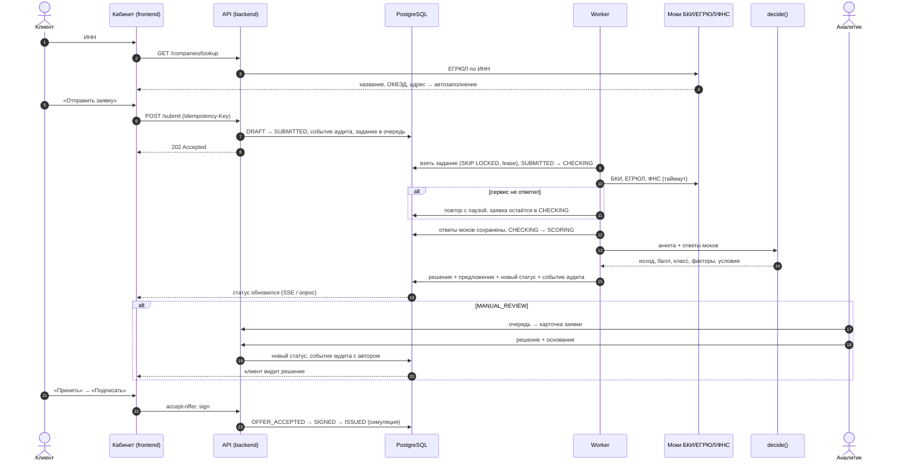

# Путь клиента и обработка заявки в банке

Владелец: Продукт · задача #25 · связано: [scope](scope.md), [карта экранов](screen-map.md), [статусы](../application-states.md), [кредитная политика](../credit-policy.md)

Документ описывает две стороны одного процесса: что переживает предприниматель (CJM) и что в это время происходит в банке — кто или что работает с заявкой, на каких данных и с каким результатом.

## Персона

**Анна, 38 лет, ИП, салон красоты на 6 мест.** Бухгалтер на аутсорсе, финансовые вопросы решает сама — вечером, с телефона или ноутбука. Нужно 2,5 млн ₽ на новое оборудование. Последний кредит брала 3 года назад: ездила в отделение два раза, собирала справки, ждала решения неделю, причину отказа по первой заявке так и не поняла.

Персона и боли — гипотезы, собранные по материалам кейса и кабинетному исследованию ([research.md](research.md)); интервью в этом цикле не проводились.

## CJM клиента

| Этап | 1. Понять, что нужно | 2. Подать заявку | 3. Ждать | 4. Получить решение | 5. Оформить | 6. Получить деньги |
| --- | --- | --- | --- | --- | --- | --- |
| **Цель** | Понять, какой кредит подходит под задачу | Заполнить заявку быстро и без ошибок | Знать, что происходит и сколько ждать | Понять ответ и что делать дальше | Подписать без поездки в банк | Деньги на счёте |
| **Действия** | Выбирает «для чего деньги», сравнивает продукты | Вводит ИНН, сумму, срок, выручку; даёт согласие на запрос в БКИ | Смотрит на таймлайн | Читает решение, сравнивает условия; при необходимости дозагружает данные | Принимает условия, подписывает | Видит статус «Деньги выданы» |
| **Экран** ([карта](screen-map.md)) | 3. «Для чего деньги» | 4. Анкета | 5. Статус | 5 + блок решения (7) | 6. Подписание | 5. Статус |
| **Мысли и эмоции** | 😟 «Кредитная линия, овердрафт — что из этого мне?» | 😐 «Опять заполнять всё про компанию вручную?» | 😟 «Её вообще кто-то смотрит? Позвонить?» | 😠 при отказе без причины · 🤔 «Дадут меньше — а что лучше: меньше или дольше?» | 😐 «Что я подписываю?» | 🙂 |
| **Боль (гипотеза)** | Банковский язык, продукты называются по-банковски, а не по задаче | Повторный ввод того, что есть в реестрах; длинные анкеты | Нет обратной связи после отправки; ожидание днями | Бинарный ответ «нет» без причины и следующего шага | Поездка в офис, бумажные документы | — |
| **Что делаем в MVP** | Подбор по цели: 6 задач → рекомендуемый продукт с параметрами простым языком | Автозаполнение по ИНН из ЕГРЮЛ/ЕГРИП; вручную — 4 поля | Таймлайн из 6 шагов, live-статус, текст «что происходит» и «что дальше» у каждого статуса; честное «отвечает дольше обычного» при сбое | 4 исхода вместо «да/нет»: контрпредложение с причиной и сравнением «Вы запрашивали / Мы предлагаем»; запрос данных с объяснением «зачем»; отказ с причиной и советом | Подписание в кабинете (симуляция) с подтверждением | Статус «Деньги выданы» |
| **Метрика** | Доля заявок, где выбран рекомендуемый продукт | Время заполнения анкеты; доля полей, заполненных автоматически | Время от отправки до решения (цель демо < 1 мин) | Доля принятых контрпредложений; повторные заявки после отказа | Доля подписанных из одобренных | Время от заявки до выдачи |

**Главные «моменты истины»:** отправка анкеты (этап 2 → 3) и получение решения (этап 4). Именно на них клиент решает, доверять ли банку. Поэтому у каждого статуса есть текст, а у каждого отказа — причина и совет.

**Альтернативные ветки:**
- **Запрос данных** (этап 4 → 3): клиент дозагружает выписку или уточняет выручку прямо на экране решения, заявка уходит на повторную проверку без новой анкеты.
- **Ручная проверка**: клиент видит «Заявку изучает специалист» и ждёт на том же экране — решение аналитика приходит туда же.
- **Отказ от предложения или отзыв заявки**: одна кнопка с подтверждением, заявка закрывается, новую можно подать сразу.

## Обработка заявки в банке

### Этапы, роли, данные и результаты

| # | Этап | Кто / что выполняет | Входные данные | Результат | Статус после этапа |
| --- | --- | --- | --- | --- | --- |
| 1 | Подготовка заявки | Клиент в кабинете; backend сохраняет черновик | Цель, продукт, ИНН, сумма, срок, выручка; ЕГРЮЛ для автозаполнения | Черновик с версией (`revision`) | `DRAFT` |
| 2 | Приём и валидация | Backend | Анкета, согласие на запрос в БКИ, `Idempotency-Key` | Заявка в очереди, событие аудита; повторная отправка не создаёт дубль | `SUBMITTED` |
| 3 | Обогащение данными | Worker (берёт задание из очереди → `CHECKING`) | ИНН → запросы к трём мокам | Сохранённые ответы БКИ, ЕГРЮЛ/ЕГРИП, ФНС ПБ; при сбое — повторы с паузой, заявка не теряется | `CHECKING` → `SCORING` |
| 4 | Стоп-факторы | `decide()` | ЕГРЮЛ (ликвидация, возраст бизнеса), ФНС (дисквалификация, налоговый долг), БКИ (просрочка 90+) | Отказ без скоринга с кодом причины | `REJECTED` |
| 5 | Достаточность данных | `decide()` | Выручка в анкете vs ФНС, наличие финданных | Список нужных документов с объяснением | `NEEDS_INFO` |
| 6 | Скоринг | `decide()` → скоркарта | 8–10 признаков: возраст бизнеса, DSCR, просрочки, запросы в БКИ, отрасль, налоги, массовый адрес, сумма/выручка | Балл, класс риска A–E, вклад каждого фактора | — |
| 7 | Кредитное решение | `decide()` → политика | Класс риска × продукт × сумма/срок × посильный платёж (DSCR ≥ 1,2) | Одобрение, контрпредложение (сумма / срок / продукт / залог) или отказ; при классе D и особых случаях — ручная проверка | `APPROVED` / `COUNTER_OFFER` / `REJECTED` / `MANUAL_REVIEW` |
| 8 | Ручная проверка | Кредитный аналитик в кабинете банка | Карточка: анкета, ответы проверок, факторы, рекомендация системы, причина ручной проверки | Решение с причиной для клиента и обоснованием для аудита | любой из 4 исходов |
| 9 | Ответ клиента | Клиент | Условия предложения | Принятие или отказ; дозагрузка данных → снова этап 3 | `OFFER_ACCEPTED` / `CANCELLED` / `CHECKING` |
| 10 | Оформление и выдача | Backend (симуляция) | Принятое предложение, согласие с договором | Подписанный договор, зачисление | `SIGNED` → `ISSUED` |

**Сквозные свойства процесса:**
- **Аудит:** каждый переход статуса — событие в `application_events` в той же транзакции; у ручных решений — автор и обоснование.
- **Разделение ролей:** клиент не видит баллов, порогов и обоснования аналитика; аналитик не может выполнять действия клиента.
- **Скорость:** этапы 2–7 автоматические, в демо занимают секунды; человек подключается только на этапе 8.

## Что дальше (развитие)

- Этап 1: предварительный лимит по ИНН ещё до анкеты (по данным моков) — клиент сразу видит, на что рассчитывать.
- Этап 8: роли верификатора и кредитного комитета с лимитами полномочий; SLA очереди и эскалация.
- Этапы 3–7: ML-модель challenger рядом с правилами (#35) — вероятность дефолта и флаг расхождения в карточке аналитика.
- Этап 10: реальная электронная подпись, график платежей, сопровождение кредита.
