# Продукт за 5 минут

Умный кредитный кабинет помогает предпринимателю получить кредит на понятную задачу и получить ответ, с которым можно работать. Банку он даёт конвейер, который сам решает типовые заявки за секунды и передаёт человеку только сложные.

Здесь — продуктовая сторона: что умеет кабинет, чем он отличается и как на него повлияло исследование. Как запустить и проверить — в [README](../../README.md); архитектура и API — в [технической документации](../architecture.md).

Скриншоты сняты 25.10.2026 с локального стенда на синтетических данных.

## Проблема

Исследование рынка ([research.md](research.md)) показало несколько повторяющихся болей предпринимателя:

- **«Нет» без объяснений.** Банки редко называют причину отказа, и непонятно, что исправить.
- **Только «да» или «нет».** Если запрошенная сумма великовата, клиент получает отказ, хотя банк мог бы дать меньше или на дольше.
- **Тишина после отправки.** Заявка ушла, а что с ней происходит, не видно.
- **Банковский язык и повторный ввод.** Продукты названы по-банковски, а данные о компании приходится вписывать вручную, хотя они есть в реестрах.

Банку при этом нужен аккуратный риск-контроль: по обзорам Банка России портфель малого бизнеса сжимается, а качество долга ухудшается, поэтому «одобрить всем» нельзя.

## Решение в одной фразе

Кредит за минуты — и понятный ответ: одобрение, другие условия, запрос данных или отказ с советом.

Принципы продукта ([scope.md](scope.md#принципы-продукта)):

1. **Сначала задача, потом продукт.** Клиент выбирает «для чего деньги», а не название кредита.
2. **Не спрашиваем то, что можем узнать сами.** Данные компании подставляются по ИНН.
3. **На каждом шаге видно, что происходит и что дальше.**
4. **Отказ всегда с причиной и советом.** Внутренние баллы и пороги клиенту не раскрываются.

## Ключевые возможности

### Для предпринимателя

**1. Кредит под задачу, а не по названию.** Клиент выбирает цель — «закупить товар», «купить оборудование», «закрыть кассовый разрыв», — и кабинет предлагает подходящие продукты с понятными условиями: сумма, срок, ставка «от», нужен ли залог.

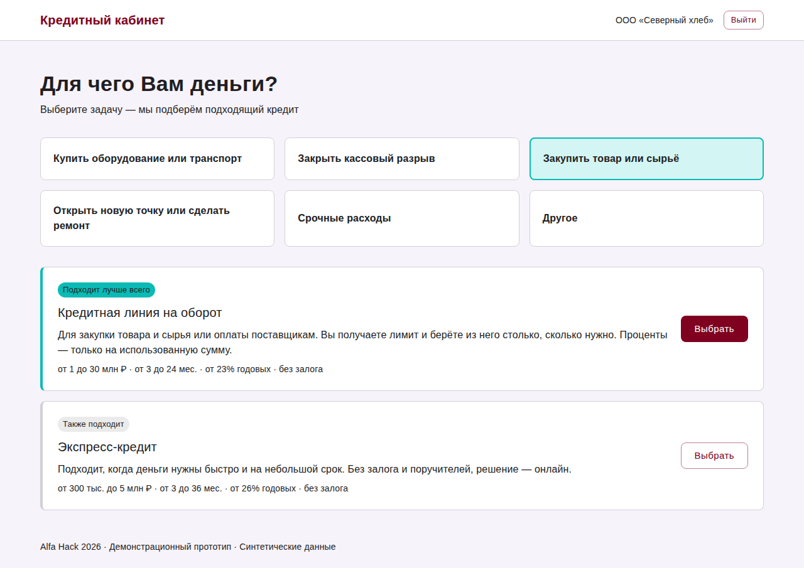

**2. Анкета из четырёх полей.** По ИНН кабинет сам заполняет название, форму, адрес, вид деятельности и дату регистрации из ЕГРЮЛ/ЕГРИП. Вручную — только сумма, срок, цель и выручка. Сразу виден ориентировочный ежемесячный платёж.

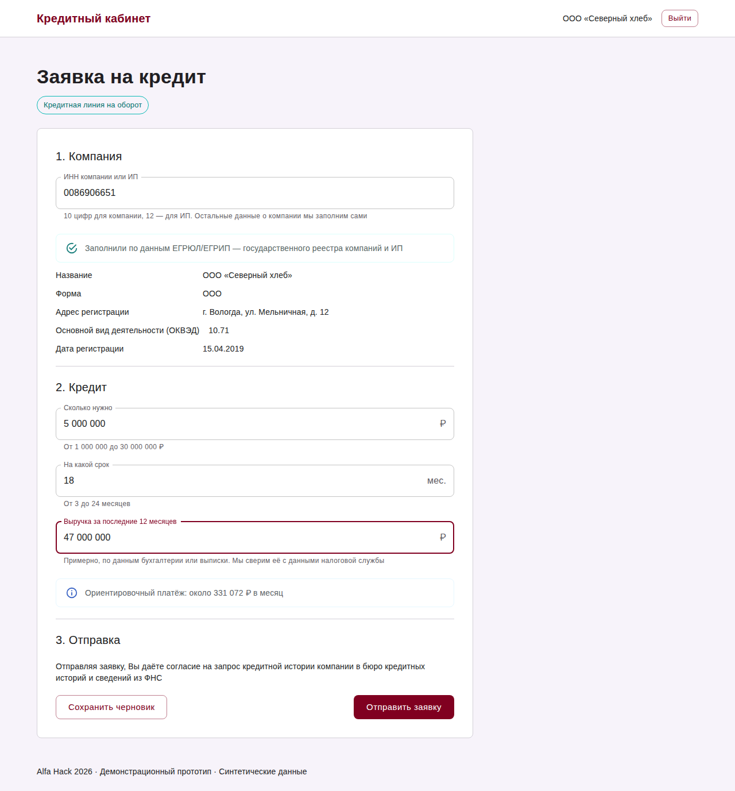

**3. Ответ, с которым можно работать.** Вместо «да» или «нет» — четыре понятных исхода:

| Одобрение | Другие условия |
| --- | --- |
| 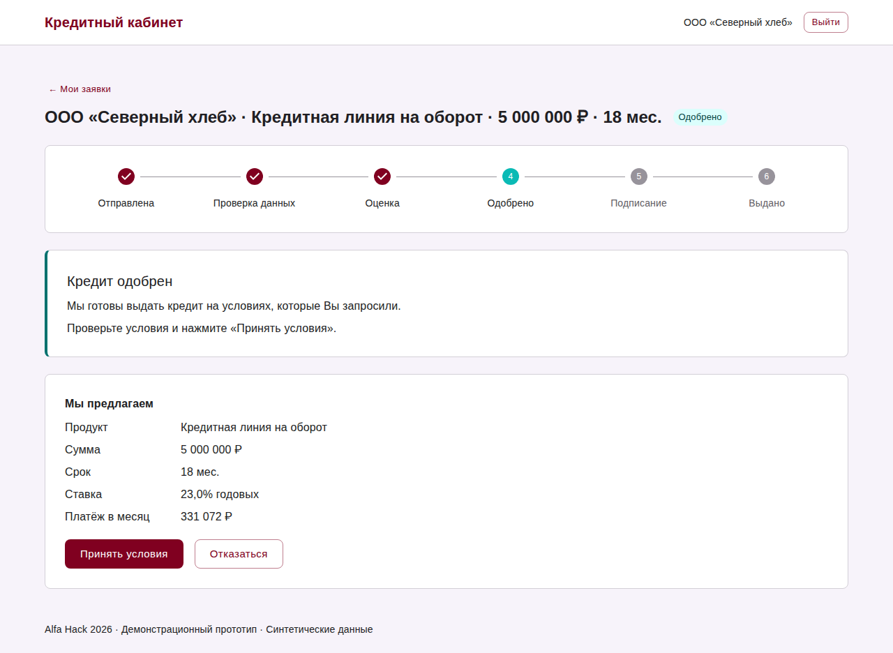 | 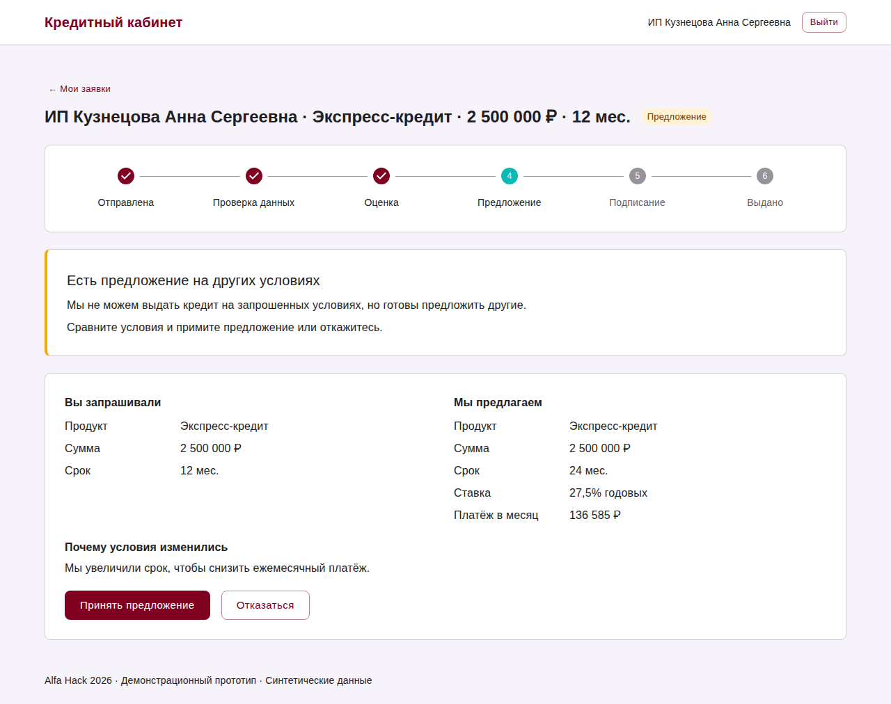 |
| **Запрос данных** | **Отказ с советом** |
| 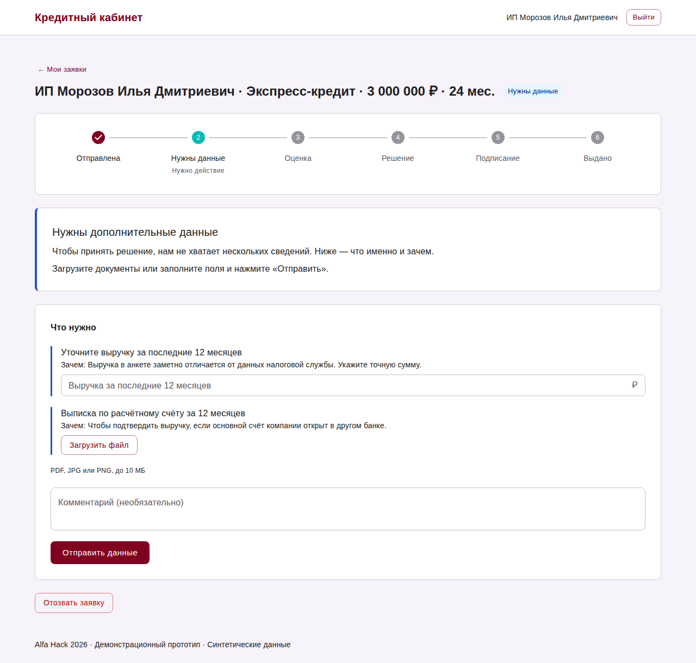 | 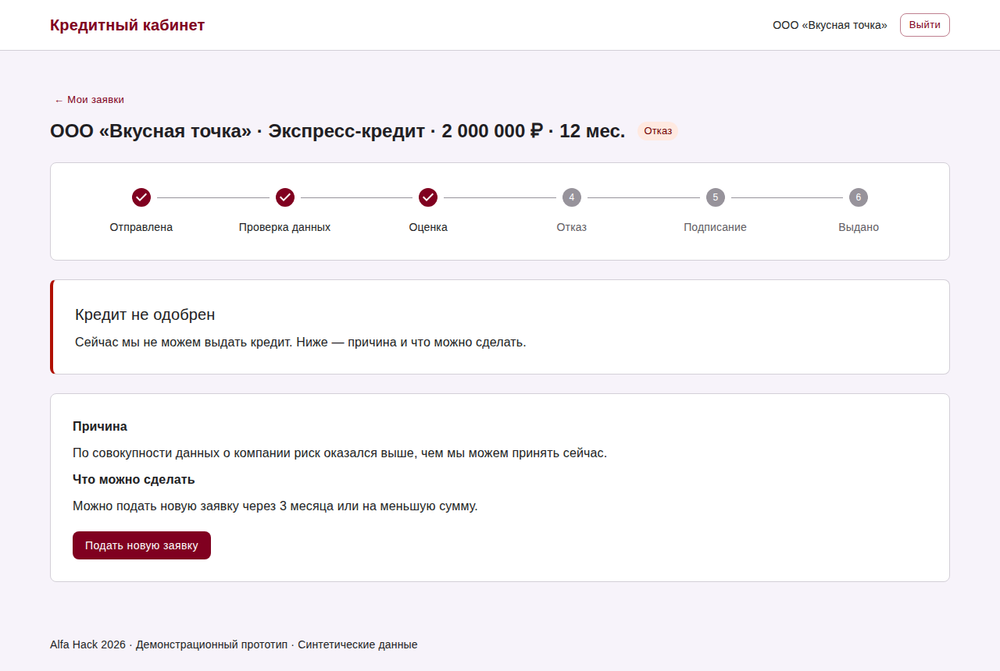 |

- **Контрпредложение** объясняет, что изменилось и почему: «мы увеличили срок, чтобы снизить ежемесячный платёж». Клиент сравнивает «вы запрашивали» и «мы предлагаем».
- **Запрос данных** называет, что именно нужно и зачем: например, уточнить выручку и приложить выписку. После этого заявка проверяется заново, без новой анкеты.
- **Отказ** говорит причину простыми словами и что можно сделать.

**4. Статус в реальном времени и спокойствие при сбоях.** Таймлайн показывает этапы — проверка данных, оценка, решение — и обновляется без перезагрузки страницы. Если внешний источник, например бюро кредитных историй, отвечает медленно, клиент видит спокойное сообщение. Банк повторяет запрос сам, заявка не теряется.

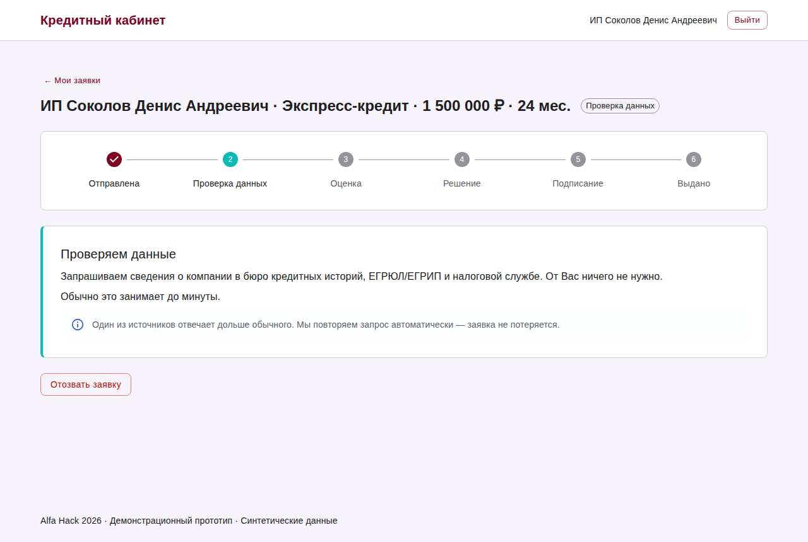

**5. Подписание и выдача без офиса.** Клиент принимает условия, подтверждает подпись кодом и сразу видит «Деньги выданы». В прототипе подписание и выдача симулируются; как это будет в боевой версии (подпись в интернет-банке или через Госключ) — в [архитектуре](../architecture.md#подписание-в-боевой-версии).

| Подтверждение кодом | Деньги выданы |
| --- | --- |
| 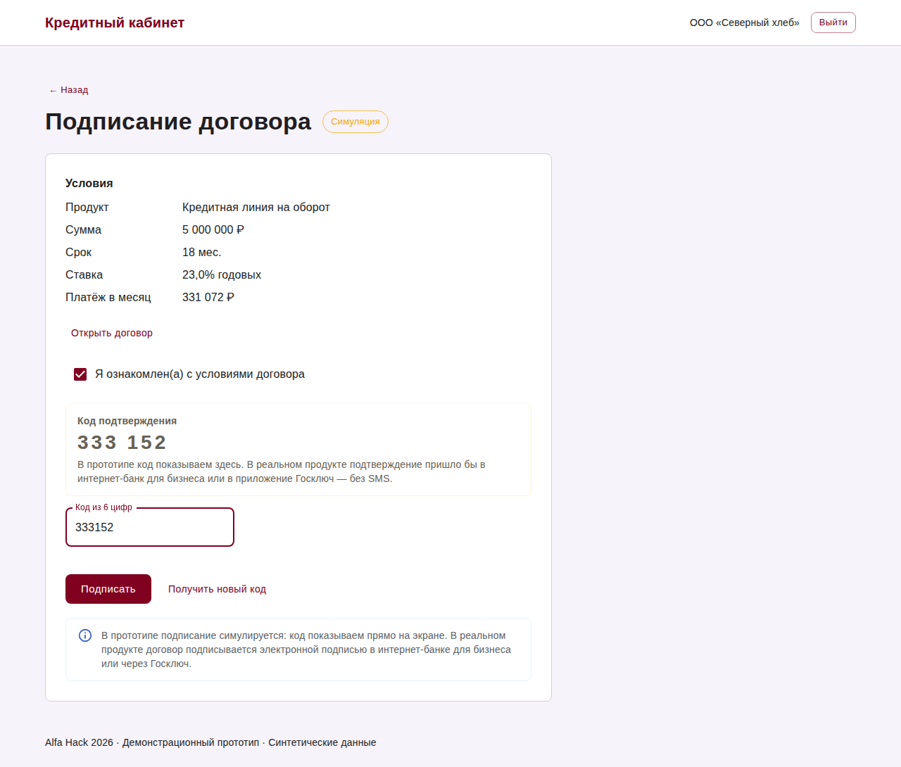 | 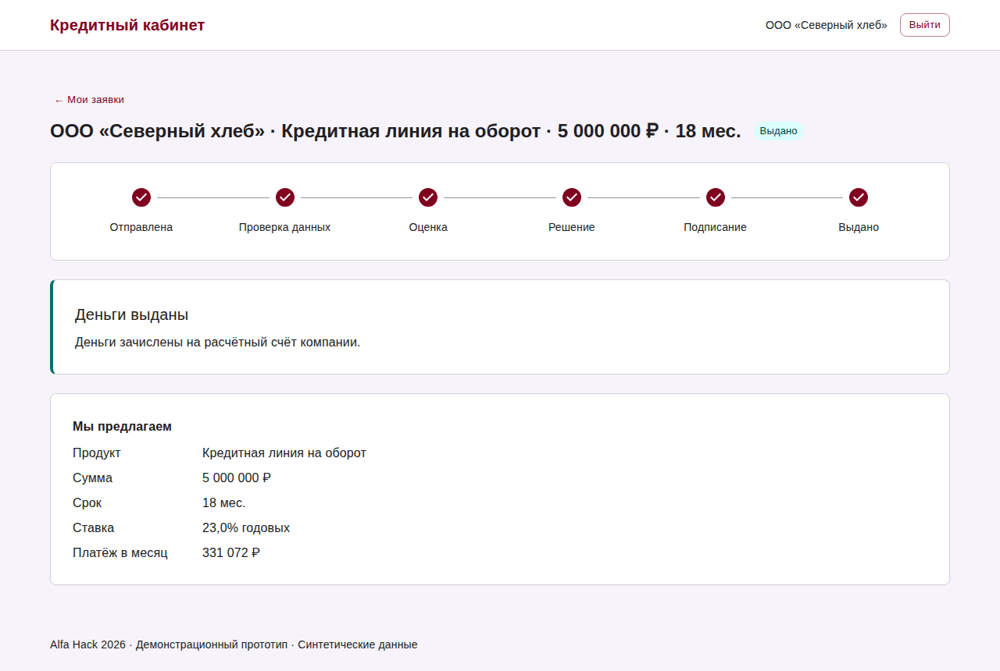 |

**6. Работает и на телефоне.** Основные экраны проверены на ширине 375 px: таймлайн становится вертикальным, ничего не уезжает за край.

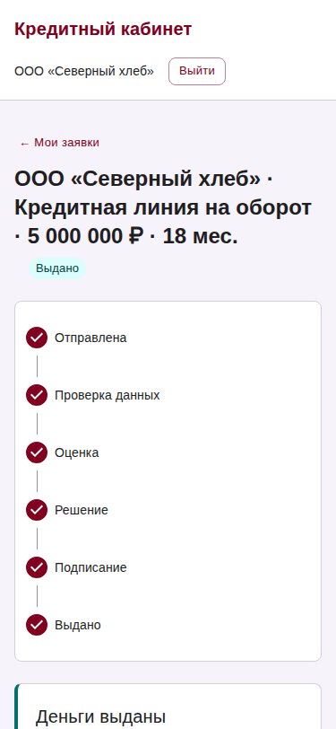

### Для банка

**7. Человек — только там, где он нужен.** Типовые заявки конвейер решает сам: проверяет компанию в БКИ, ЕГРЮЛ/ЕГРИП и ФНС, отсекает стоп-факторы, считает скоринг и подбирает условия. Аналитику достаются только «серая зона» и крупные суммы с залогом. Сводка конвейера показывает, сколько заявок на каком этапе, сколько ждут аналитика, долю решений без участия человека и время до решения.

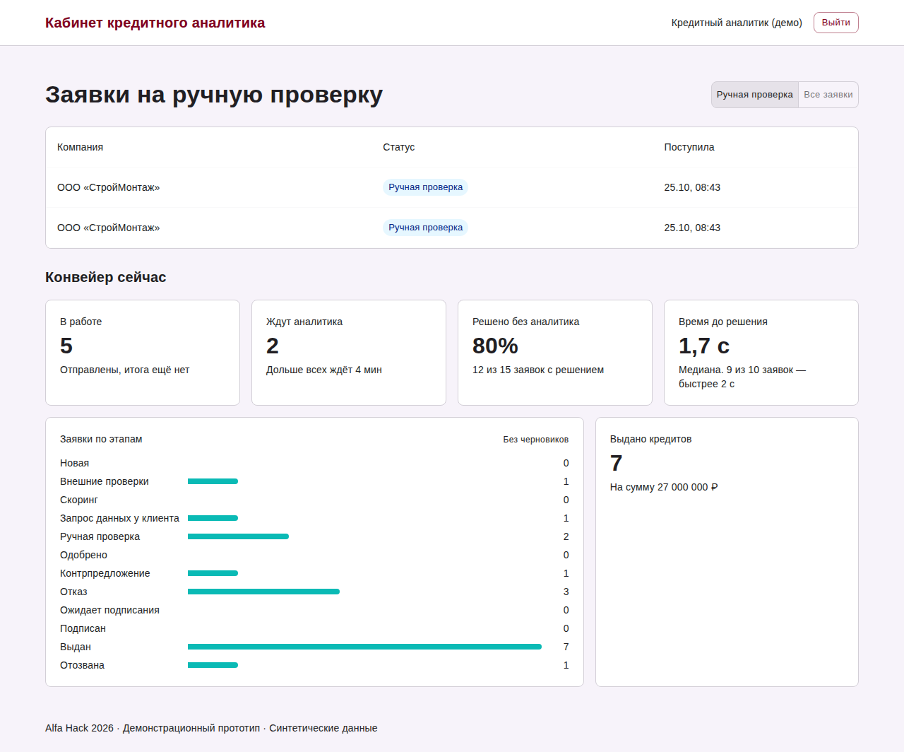

**8. Решение аналитика — за минуты, с обоснованием.** В карточке — анкета, балл и класс риска, вклад каждого фактора, причина передачи на ручную проверку («серая зона скоринга») и рекомендация системы. Аналитик выбирает исход и обязательно пишет обоснование; клиент видит своё объяснение, внутреннее остаётся у банка.

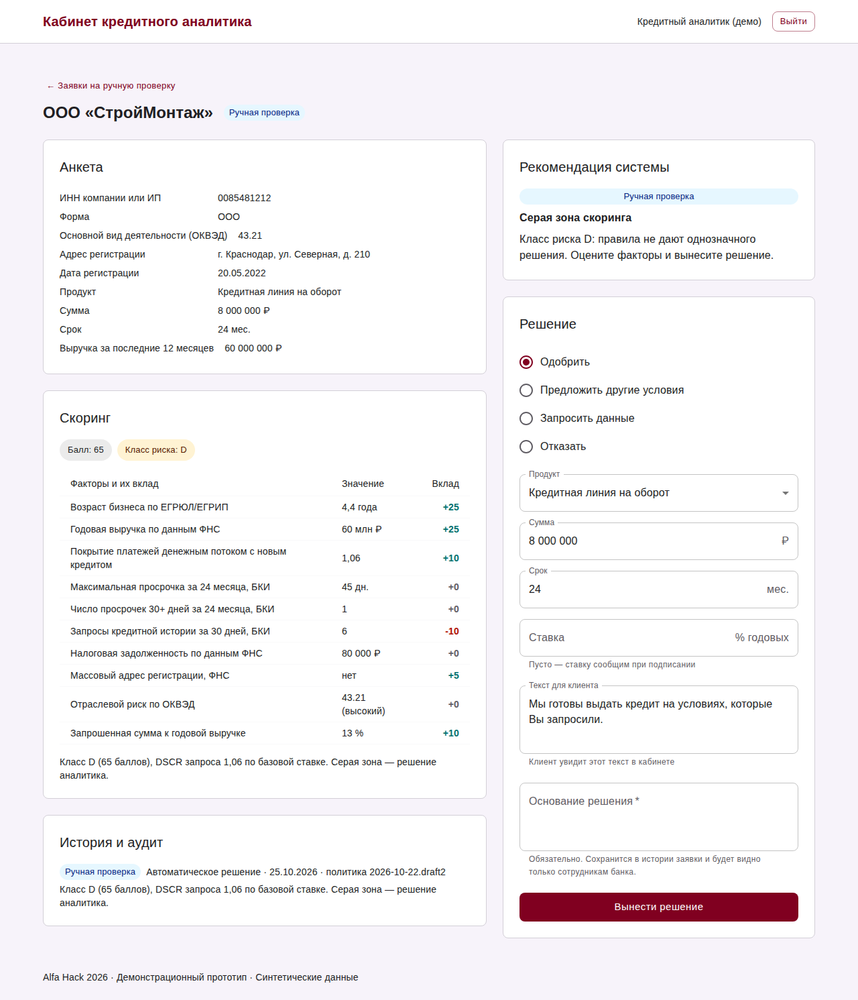

## Как это работает

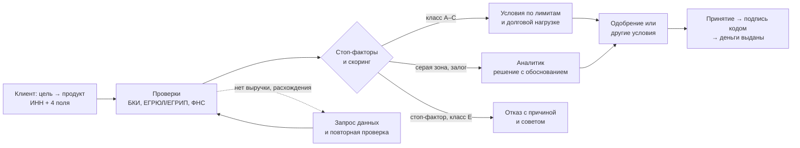

Подробные схемы пути клиента и обработки в банке — в [cjm.md](cjm.md); правила решения и ставки — в [кредитной политике](../credit-policy.md).

## Что дало исследование и как это повлияло на продукт

| Что выяснили | Что сделали в продукте | Где увидеть |
| --- | --- | --- |
| Отказывают часто и почти никогда не объясняют | Каждый отказ — с причиной простыми словами и советом, что можно сделать; словарь причин согласован с кредитной политикой | Скриншот 6, [тексты интерфейса](ui-texts.md) |
| Ответ бинарный: «нет» вместо «меньше или дольше» | Четыре исхода; контрпредложение подбирает срок, сумму или другой продукт и объясняет, что изменилось | Скриншот 4, [кредитная политика](../credit-policy.md) |
| После отправки клиент ничего не видит | Таймлайн этапов с живым обновлением; у каждого статуса — «что происходит» и «что дальше»; спокойное сообщение при медленном источнике | Скриншоты 3, 12 |
| Продукты названы по-банковски | Подбор по цели («закупить товар»), а не по названию продукта; обращение на «Вы», без жаргона | Скриншот 1 |
| Данные о компании вводят повторно, хотя они есть в реестрах | Автозаполнение по ИНН из ЕГРЮЛ/ЕГРИП; вручную — только сумма, срок, цель и выручка | Скриншот 2 |
| Лидеры рынка дают решение за минуты — это гигиена, а не преимущество | Автоматический конвейер: решение за секунды, ручная проверка только для серой зоны | Скриншот 9, README → «Ресурсы и скорость» |
| Качество долга малого бизнеса ухудшается | Стоп-факторы, скоркарта с классами риска, проверка долговой нагрузки (DSCR ≥ 1,2), аудит каждого шага | [Кредитная политика](../credit-policy.md) |
| Ставки должны отражать рынок и ключевую ставку | Базовые ставки = ключевая ставка ЦБ + расходы банка + премия за риск продукта | [Почему такие ставки](../credit-policy.md#почему-такие-ставки) |

Интервью с предпринимателями в этом цикле не проводились: боли и JTBD основаны на кабинетном исследовании и материалах кейса ([research.md](research.md)).

## Преимущества

**Для предпринимателя:** кредит под задачу без банковского языка; анкета из четырёх полей; ответ за секунды; понятный следующий шаг при любом исходе, включая отказ; подписание без офиса.

**Для банка:** большинство заявок решается без участия человека; аналитик работает только со сложными случаями и видит объяснимые факторы; каждое решение и переход статуса записаны в журнал; сбой внешнего сервиса не теряет заявку.

**Цифры с нашего стенда** (синтетические данные, замеры в README → [«Ресурсы и скорость»](../../README.md#ресурсы-и-скорость)):

| Показатель | Значение |
| --- | --- |
| От отправки заявки до решения | медиана 1,7 с, 9 из 10 заявок — быстрее 2 с |
| Решено без участия аналитика | 80% — 12 из 15 заявок; остальные 3 — серая зона, их решает аналитик |
| Если бюро кредитных историй не отвечает | два автоматических повтора, решение через ≈ 11 с, заявка не теряется |
| Ресурсы | весь стенд — около 300 МБ оперативной памяти, GPU не нужен |

Доля решений без аналитика зависит от набора заявок: на стенде это 9 тестовых сценариев, которые нарочно покрывают все исходы, поэтому «сложных» случаев здесь больше, чем в обычном потоке.

## Что дальше

Предварительный лимит по ИНН ещё до анкеты, роли верификатора и кредитного комитета, подпись через интернет-банк или Госключ, госпрограммы поддержки, ML-модель как вторая оценка для аналитика ([почему она пока не влияет на решение](../architecture.md#challenger-модель-вероятности-дефолта-35)). Полный список — в [scope.md](scope.md#развитие-для-презентации).

## Где подробнее

| Документ | О чём |
| --- | --- |
| [research.md](research.md) | Рынок, как кредитуют конкуренты, боли предпринимателя, выводы для MVP |
| [cjm.md](cjm.md) | Персона, путь клиента и обработка заявки в банке |
| [scope.md](scope.md) | Пользователи, JTBD, что делаем и что осознанно не делаем |
| [screen-map.md](screen-map.md) | Все экраны и переходы между ними |
| [Кредитная политика](../credit-policy.md) | Стоп-факторы, скоркарта, исходы, ставки |
| [pitch.md](pitch.md) | Сценарий демо и ответы на вопросы жюри |
