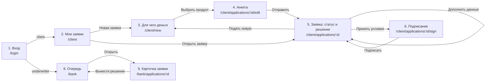

# Карта экранов

Статус: **черновик на согласование с фронтендом** · владельцы: Фронтенд + Продукт · задача #10

Для каждого экрана указаны маршрут, назначение, данные (эндпоинты из [`openapi.yaml`](../openapi.yaml)), действия и ключи текстов из [`ui-texts.ru.json`](ui-texts.ru.json). Макеты описаны текстом, их собирают из компонентов MUI. Порядок блоков сверху вниз совпадает с порядком на экране.

Какие кнопки показывать, определяет поле `allowed_actions` заявки (`edit`, `submit`, `cancel`, `accept_offer`, `provide_info`, `upload_document`, `sign`), а не статус. Так фронт не дублирует статусную машину.

## Переходы



Экран 7 — это состояния экрана 5, отдельного маршрута у него нет.

## Кабинет клиента

### 1. Вход — `/login`

Общий для обеих ролей. После входа `GET /api/auth/me` возвращает роль: `client` попадает на `/client`, `underwriter` на `/bank`.

```
[Кредитный кабинет]
Логин        [__________]
Пароль       [__________]
[ Войти ]
мелко: Тестовые аккаунты клиента и аналитика указаны в README
```

| | |
| --- | --- |
| API | `GET /api/auth/csrf` → `POST /api/auth/login` → `GET /api/auth/me` |
| Тексты | `login.*` |
| Состояния | ошибка → `login.errorInvalid` |

### 2. Мои заявки — `/client`

```
Мои заявки                                [ Новая заявка ]
┌ ООО «Ромашка» · Экспресс-кредит · 2 000 000 ₽ · 24 мес.
│ [чип статуса: Проверка данных]          Отправлена 21.10
└ ...
Пусто: «У Вас пока нет заявок» [ Подобрать кредит ]
```

| | |
| --- | --- |
| API | `GET /api/applications` |
| Тексты | `applications.*`; чип — `statuses.<STATUS>.timeline` |
| Состояния | пусто, загрузка, ошибка (`errors.generic`) |

### 3. Для чего деньги — `/client/new`

Сначала задача, потом продукт. Плитки целей; по клику ниже раскрываются подходящие продукты.

```
Для чего Вам деньги?
Выберите задачу — мы подберём подходящий кредит
[Купить оборудование] [Закрыть кассовый разрыв] [Закупить товар]
[Открыть точку / ремонт] [Срочные расходы] [Другое]

── после выбора цели ──
★ Подходит лучше всего
  Инвестиционный кредит — Крупная сумма на развитие бизнеса
  от 3 до 100 млн ₽ · до 84 мес. · под залог            [ Выбрать ]
Также подходит
  Экспресс-кредит — ...                                 [ Выбрать ]
```

| | |
| --- | --- |
| API | `GET /api/products`; по «Выбрать» — `POST /api/applications` (черновик с `product_id` и `purpose`) |
| Тексты | `productPicker.*`, `purposes.<code>.label`, `products.<code>.*` |
| Логика | порядок продуктов берём из `purposes.<code>.products`, первый — рекомендуемый |

### 4. Анкета — `/client/applications/:id/edit`

Одна страница, три блока. Автосохранение черновика не нужно, есть кнопка «Сохранить черновик».

```
Заявка на кредит · Инвестиционный кредит [изменить]

1. Компания
ИНН компании или ИП [__________]  (поиск после 10/12 цифр)
  ✓ Заполнили по данным ЕГРЮЛ/ЕГРИП
  Название · Форма · Адрес · ОКВЭД · Дата регистрации   (только чтение)

2. Кредит
Сколько нужно   [_______] ₽    От 3 000 000 до 100 000 000 ₽
На какой срок   [___] мес.
Выручка за последние 12 месяцев [_______] ₽
  Ориентировочный платёж: около 85 000 ₽ в месяц      (Should)

3. Отправка
мелко: Отправляя заявку, Вы даёте согласие на запрос кредитной истории…
[ Сохранить черновик ]                      [ Отправить заявку ]
```

| | |
| --- | --- |
| API | `GET /api/companies/lookup?inn=` → `PATCH /api/applications/{id}` (с `expected_revision`) → `POST /api/applications/{id}/submit` |
| Тексты | `form.*` |
| Состояния | ИНН не найден → `form.inn.errorNotFound`, но поля можно заполнить вручную; ошибки полей из `field_errors`; конфликт версий → `errors.conflict` |
| После отправки | переход на экран 5 |

### 5. Заявка: статус и решение — `/client/applications/:id`

Главный экран демо. Сверху таймлайн, под ним карточка текущего статуса, ниже блок решения (экран 7).

```
ООО «Ромашка» · Инвестиционный кредит · 5 000 000 ₽ · 36 мес.

● Отправлена ── ● Проверка данных ── ◌ Оценка ── ○ Решение ── ○ Подписание ── ○ Выдано

┌ Проверяем данные
│ Запрашиваем сведения о компании в бюро кредитных историй, ЕГРЮЛ/ЕГРИП
│ и налоговой службе. От Вас ничего не нужно.
│ Обычно это занимает до минуты.
└
[блок решения — см. экран 7]
История заявки ▸                                 [ Отозвать заявку ]
```

| | |
| --- | --- |
| API | `GET /api/applications/{id}` + SSE `GET /api/applications/{id}/events`; `GET .../history` |
| Тексты | `statuses.<STATUS>.{title,description,next}`; таймлайн — `statuses.*.timeline`; отзыв — `applications.cancel*` |
| Live | при событии `status_changed` перечитать заявку. При обрыве SSE показать `errors.liveUpdatesLost` и переподключиться |
| Долгий `CHECKING` | если статус не меняется дольше **4 с**, показать `statuses.CHECKING.slow`. Обычная проверка занимает ~1,5 с, повторы при сбое БКИ — ~9 с (прогон QA 22.10): при пороге 10 с плашку не видно. Отдельного события ретрая в контракте нет |

**Таймлайн — 6 шагов для клиента.** 13 статусов клиенту не показываем: технические сворачиваются в понятные этапы.

| Шаг таймлайна | Статусы |
| --- | --- |
| Отправлена | `SUBMITTED` |
| Проверка данных | `CHECKING`, `NEEDS_INFO` (шаг подсвечен «нужно действие») |
| Оценка | `SCORING`, `MANUAL_REVIEW` (подпись «Проверка специалистом») |
| Решение | `APPROVED`, `COUNTER_OFFER`, `REJECTED` |
| Подписание | `OFFER_ACCEPTED`, `SIGNED` |
| Выдано | `ISSUED` |

`CANCELLED` и `REJECTED` останавливают таймлайн: последний шаг серый с подписью статуса.

### 6. Подписание — `/client/applications/:id/sign`

```
Подписание договора                           [Симуляция]
Условия: Инвестиционный кредит · 4 000 000 ₽ · 48 мес. · 85 000 ₽/мес.
[ Открыть договор ]
☐ Я ознакомлен(а) с условиями договора
[ Подписать ]   (активна после галочки)
мелко: В прототипе подписание симулируется…
```

| | |
| --- | --- |
| API | `POST /api/applications/{id}/sign` → возврат на экран 5, где видно `SIGNED` → `ISSUED` |
| Тексты | `signing.*` |

### 7. Блок решения (внутри экрана 5)

| Статус | Что показываем | Действия → API |
| --- | --- | --- |
| `APPROVED` | Условия: продукт, сумма, срок, ставка, платёж | «Принять условия» → `POST accept-offer` → экран 6; «Отказаться» → диалог → `POST cancel` |
| `COUNTER_OFFER` | Две колонки «Вы запрашивали» и «Мы предлагаем», блок «Почему условия изменились» (`counterOfferReasons`) | «Принять предложение» → `POST accept-offer` → экран 6; «Отказаться» → диалог `decision.declineConfirm` → `POST cancel` |
| `NEEDS_INFO` | Список `required_docs`: название и «зачем»; у каждого пункта кнопка загрузки или поле ввода (выручка) | `POST documents` на каждый файл, затем «Отправить данные» → `POST additional-info` |
| `MANUAL_REVIEW` | Только карточка статуса, без действий | — |
| `REJECTED` | «Причина» (`rejectionReasons.<code>.message`) и «Что можно сделать» (`.advice`) | «Подать новую заявку» → экран 3 |

Тексты — `decision.*`. Если с бэка пришёл неизвестный код причины, показываем `message` из ответа API.

## Кабинет банка

### 8. Очередь — `/bank`

```
Заявки на ручную проверку
Компания        ИНН          Продукт        Сумма       Класс  Поступила
ООО «Вектор»    7701234567   Экспресс       3 000 000   C      21.10 14:02  ▸
Пусто: «Новых заявок нет»
```

| | |
| --- | --- |
| API | `GET /api/underwriter/applications` `?status=MANUAL_REVIEW` по умолчанию; переключатель «Все заявки» для демо |
| Тексты | `bank.queue.*` |

### 9. Карточка заявки — `/bank/applications/:id`

Две колонки: слева данные, справа решение.

```
ООО «Вектор» · ИНН 7701234567 · Экспресс-кредит · 3 000 000 ₽ · 24 мес.
[чип: Ручная проверка]

ЛЕВАЯ КОЛОНКА                                  ПРАВАЯ КОЛОНКА
Анкета            (сумма, срок, цель, выручка)   Рекомендация системы: Ручная проверка
Внешние проверки                                 Класс риска: C · Балл: 512
  БКИ — 2 кредита, платёж 120 000 ₽, 30+: 1      ┌ Решение
  ЕГРЮЛ — действующая, 4 года, ОКВЭД 47.11       │ (•) Одобрить ( ) Другие условия
  ФНС ПБ — долгов нет, массовый адрес: да        │ ( ) Запросить данные ( ) Отказать
Факторы и их вклад                               │ [поля по выбранному исходу]
  Возраст бизнеса   4 года    +40                │ Причина для клиента [код ▾]
  DSCR              1,1       −35                │ Основание решения* [_______]
  ...                                            │ [ Вынести решение ]
Оценка ML-модели (не влияет на решение)          └
  Вероятность дефолта 7,8% · расходится с правилами
История и аудит ▸   Документы клиента ▸
```

| | |
| --- | --- |
| API | `GET /api/underwriter/applications/{id}` → `POST .../decision` (по исходу: `ManualApprovalRequest`, `ManualCounterOfferRequest`, `ManualNeedsInfoRequest`, `ManualRejectionRequest`) |
| Тексты | `bank.card.*`, `bank.challenger.*`, `bank.decision.*`; причины для клиента — выпадающий список из `rejectionReasons` / `counterOfferReasons` / `requiredDocuments` |
| После решения | тост `bank.decision.done` → возврат в очередь. Клиент видит решение по SSE |
| ML-блок | показываем, только если бэк вернул данные challenger (#35) |
| Рекомендация системы | при `MANUAL_REVIEW` — заголовок и пояснение из `manualReviewReasons[review_reason]`, а не клиентский текст статуса. Статус в заголовке карточки — один чип (`statuses.*.bank`) |
| Класс риска | цвет чипа по [design-tokens](design-tokens.md#классы-риска): A–B тиффани, C нейтральный, D янтарь, E красный |

## Что нужно от команды

- **Фронтенд:** подтвердить маршруты и решить, нужен ли отдельный экран для выбора продукта или хватит раскрытия на экране 3. Завести задачу на кабинет банка (экраны 8–9), сейчас её нет.
- **Бэкенд:** по желанию — событие ретрая внешней проверки в SSE (сейчас есть `status_changed`, `application_updated`, `decision_created`, `document_uploaded`). Без него фронт показывает «отвечает дольше обычного» по таймеру в 4 с.
- **Риски:** формат факторов в карточке (`ScoringFactor.value` и `contribution`) должен читаться человеком, например «4 года» и «+40».
